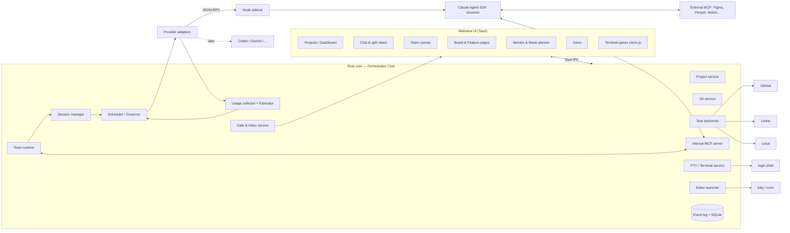

# Orchestrator — Product & Technical Specification

> Status: **Draft v0.1** · Owner: Guillaume · Last update: 2026-10-17
> Scope of this document: *what* we build and *why*, plus the high-level *how*. Implementation details live in ADRs (`docs/adr/`) and later design docs.

---

## 1. Vision

Orchestrator is a **personal, local-first desktop app** to run software projects with AI agents. It extends what the Claude app / Claude Code offer for a single developer who juggles several projects:

- one place for all **projects** (local folders + git remote state),
- **solo sessions or whole teams of specialist agents** (lead, backend, frontend, UI, UX…) working in parallel, each isolated in its own git worktree,
- **a Claude‑Code‑grade chat** with any agent, plus a **real terminal** and **your own editor (nvim)**,
- **full visibility on usage** (plan limits, context, tokens) and — key differentiator — **pacing**: the app spreads agent work so the Max plan lasts the whole week instead of running out on Wednesday.

### 1.1 Goals
| # | Goal |
|---|---|
| G1 | Manage many projects and see their git/remote/PR state at a glance. |
| G2 | Launch and run many agent sessions in parallel, safely isolated. |
| G3 | Compose teams of agents visually and let a lead agent coordinate them on a feature. |
| G4 | Interact with any agent through a chat at least as capable as Claude Code's. |
| G5 | Keep the developer's own tools: terminal that feels like kitty, nvim with their config. |
| G6 | Monitor usage live and **pace all work against the plan's weekly and 5h limits**. |
| G7 | Integrate with the developer's PM/design stack: GitHub, Linear, Notion, Figma, Penpot. |
| G9 | Have a designed, consistent UI: a Penpot file is the source of truth for the interface. |
| G8 | Stay provider-agnostic: Claude Code first, other agent CLIs later. |

### 1.2 Non-goals (for now)
- Multi-user collaboration, shared workspaces, hosted/cloud service, accounts.
- A built-in code editor (we delegate to the user's editor).
- Replacing GitHub/Linear as a PM tool — we sync, we don't compete.
- Windows/Linux support in the first versions (macOS first, keep it portable).
- Running agents on remote machines/cloud sandboxes (possible later via providers).

---

## 2. Glossary

| Term | Definition |
|---|---|
| **Project** | A local directory registered in the app (usually a git repository). |
| **Feature** | A unit of product work inside a project (e.g. "Checkout v2"). Owns a spec folder, tasks, a team run, an integration branch. |
| **Session** | One conversation with one agent instance, backed by a provider session (e.g. a Claude Code session). Has a transcript, a cwd/worktree, usage. |
| **Agent** | A running instance of a **Role** inside a Session. |
| **Role** | A reusable agent definition: system prompt, model, effort, tools, MCP servers, permissions, worktree policy. |
| **Team** | A graph of Roles (nodes) and relations (edges) authored in the visual builder. |
| **Lead** | The Role in a Team that decomposes work, assigns tasks, and integrates results. |
| **Task** | A unit of work assigned to an agent. Lives in the project's configured **task backend** (local / GitHub / Linear). |
| **Worktree** | A git worktree + branch dedicated to one agent/session. |
| **Gate** | A point where an agent must wait for user approval (spec, merge/PR, out-of-sandbox action, budget). |
| **Inbox** | Central queue of gates, permission requests, and agent questions. |
| **Provider** | An adapter to an agent runtime (Claude Agent SDK first). |
| **Governor** | The scheduler that admits, delays, downgrades or pauses agent turns to respect the usage plan. |
| **Weekly plan** | The user's budget allocation for the current plan week (working hours, shares per project, reserve). |

---

## 3. Persona & key user journeys

**Persona — Guillaume**: senior developer, works alone on several projects in parallel, Claude Max subscriber, lives in kitty + nvim, uses GitHub, Linear, Notion, Figma/Penpot. Wants leverage (many agents) without losing control (gates, own tools) or blowing the weekly limit.

### J1 — Add a project and see its state
1. Click **Add project** → pick a folder (or clone a URL).
2. App detects git, default branch, remotes; runs a background `git fetch`.
3. Project card shows: current branch, ahead/behind remote, dirty files count, open PRs, CI status, active agents, week budget share.

### J2 — Solo session in a worktree
1. From the project, **New session** → choose role (or "plain Claude"), model, base branch, worktree on/off (default on).
2. App creates `orchestrator/<session-slug>` branch + worktree, starts the agent.
3. User chats; tool calls, diffs, todos stream in. User opens a terminal pane in the same worktree to run tests (J6) or opens a file in nvim (J7).
4. At the end: **Create PR** (gate) or **Merge into base**, then cleanup worktree.

### J3 — Team on a feature
1. User opens the **Team canvas**, drags *Lead*, *Backend*, *Frontend*, *UI designer*, *UX designer*; connects edges (reports‑to Lead, UX → UI handoff, Frontend reviews UI).
2. **Launch on feature** → pick/create a Feature, write a 3‑line brief.
3. Lead drafts `spec.md`, UX brief, API contract in `.orchestrator/features/<slug>/` → **Spec gate** in the Inbox.
4. User comments/approves. Lead creates tasks in the project's task backend and assigns them.
5. Specialists work in parallel, each in its own worktree branched from the feature integration branch; UI/UX roles use Figma/Penpot MCP.
6. Specialists report via the orchestrator MCP tools; Lead reviews, requests fixes, merges branches into the integration branch.
7. **PR gate**: user reviews the integration diff and approves PR creation (GitHub). Feature closed when merged.

### J4 — Monitor everything
1. **Monitor** view lists all running agents across projects: state (thinking / tool / waiting approval / queued by governor / idle / error), current tool, files touched, context %, tokens this session.
2. User can pause, resume, interrupt, kill, or change model of any agent.

### J5 — Inbox
1. A badge shows pending items. Each item: who asks, what, why, diff/preview, actions (Approve / Reject / Reply / Open session).
2. Answering unblocks the agent immediately.

### J6 — Terminal
1. In any session or project, **Open terminal** → a pane opens with the user's login shell, cwd = worktree.
2. The pane looks like the user's kitty (font, colors, ligatures, padding read from `kitty.conf`). Tabs and splits are available. **Open in kitty** is a shortcut to the real kitty at the same cwd.

### J7 — Edit in nvim
1. Click a file path / diff hunk / tool-call card → **Open in editor**.
2. nvim opens at the line (embedded pane by default, or kitty window). User edits and saves.
3. The app detects the change and (optionally) informs the agent: "User edited `src/x.ts` lines 10–24".

### J8 — Pacing the week
1. Monday (or at plan reset), the **Week planner** opens: working days/hours, projects A 50 % / B 30 % / C 20 %, 10 % reserve for ad‑hoc chats. Prefilled from last week.
2. Title bar shows a pacing indicator: *On track · 41 % used · ideal 38 % · resets Mon 09:00*.
3. Wednesday the burn rate is too high: the Governor queues low‑priority team tasks, caps concurrency to 3, switches the Lead to a cheaper model, and proposes in the Inbox to defer feature "Search v2" to next week.
4. Thursday night, spare 5h windows are used for queued long tasks (off‑hours scheduling).
5. The week ends at ~95 % usage near the reset. A weekly report summarizes usage per project/feature/role and pacing accuracy.

---

## 4. Functional requirements

Priority: **M** = must, **S** = should, **C** = could. Journey refs in brackets.

### 4.1 Projects & Git
| ID | Requirement | P |
|---|---|---|
| FR-101 | Register a local folder as a project; clone from URL as a shortcut. [J1] | M |
| FR-102 | Show branch, ahead/behind upstream, dirty/staged/untracked counts, last commit, stash count. [J1] | M |
| FR-103 | Periodic + on-demand `git fetch` per project (configurable interval, off when on battery/offline). [J1] | M |
| FR-104 | List branches and worktrees, including orphaned orchestrator worktrees, with one-click cleanup. | M |
| FR-105 | Worktree lifecycle: create from a base branch, name `orchestrator/<feature>/<role>-<n>`, located **inside the repo** at `.orchestrator/worktrees/…` (ignored through `.git/info/exclude`, see ADR-003), delete with branch protection checks (never delete unmerged work without confirmation). [J2,J3] | M |
| FR-106 | Show GitHub PRs and CI checks for the project (via `gh` / GitHub API). [J1] | S |
| FR-107 | Diff viewer per worktree (vs base, vs integration branch), file tree with change markers. | M |
| FR-108 | Merge/rebase helpers with conflict detection; conflicts can be handed to an agent to resolve. | S |
| FR-109 | Per-project settings: default base branch, task backend, default team, budget share, env/setup script run on worktree creation (e.g. `pnpm install`). | M |

### 4.2 Sessions & chat
| ID | Requirement | P |
|---|---|---|
| FR-201 | Create, resume, fork, rename, archive sessions; sessions survive app restarts. [J2] | M |
| FR-202 | Run N sessions in parallel across projects (target ≥ 10 concurrent). | M |
| FR-203 | Streaming chat with markdown, code blocks, tool-call cards (collapsible input/output), inline diffs, todo/plan rendering. [J2] | M |
| FR-204 | Composer: multiline, `@file` mentions with fuzzy finder, image paste/drag, slash commands (provider + app commands), history. | M |
| FR-205 | Interrupt, steer (queue a message while the agent works), switch model/effort/permission mode mid-session, plan mode. | M |
| FR-206 | Context indicator per session (tokens used / window, compactions) and a "compact now" action. | M |
| FR-207 | Split view: several sessions side by side; a session can dock terminal and editor panes. | M |
| FR-208 | Search across session transcripts (per project / global). | S |
| FR-209 | Export a transcript (markdown/JSON). | C |
| FR-210 | Notifications (macOS) when an agent finishes, errors, or needs input. | M |

### 4.3 Agent & team builder (visual only)
| ID | Requirement | P |
|---|---|---|
| FR-301 | Canvas editor: add/move/connect nodes, zoom/pan, auto-layout, undo/redo. [J3] | M |
| FR-302 | Node = Role config: name, icon/color, system prompt (markdown editor in a side panel), model, effort, allowed tools, MCP servers, permission profile, worktree policy (own / shared with X / read-only), max concurrency, budget priority. | M |
| FR-303 | Edge types: **reports-to**, **hands-off-to** (artifact handoff), **reviews**, **can-message**. Edges define who may talk to whom. | M |
| FR-304 | Exactly one Lead per team (validated). Team-level settings: integration branch policy, gates enabled, budget cap. | M |
| FR-305 | Library of reusable Roles and Team presets (global or per project), duplicate/version them. | M |
| FR-306 | Import/export Teams and Roles as JSON (backup/share between machines). | S |
| FR-307 | Ship starter presets: *Solo dev*, *Full-stack feature team* (Lead, Backend, Frontend, UI, UX, Reviewer), *Bugfix squad*, *Design sprint*. | S |
| FR-308 | Team definitions are compiled at launch into provider agent definitions (prompts + tools + MCP + permissions); compiled output is inspectable (read-only) for debugging. | M |

### 4.4 Orchestration runtime
| ID | Requirement | P |
|---|---|---|
| FR-401 | Lead protocol: *understand → spec → (spec gate) → decompose → assign → track → review → integrate → (PR gate)*. [J3] | M |
| FR-402 | Orchestrator exposes an internal **MCP server** to every agent with tools: `post_message(to, body)`, `read_messages()`, `create_task`, `update_task(status, notes)`, `list_tasks`, `request_review(branch)`, `handoff(artifact, to)`, `ask_user(question, options)`, `report_done(summary)`. Access is limited by the team graph edges. | M |
| FR-403 | Task dependencies (blocked-by); an agent is started only when its task's dependencies are done. | M |
| FR-404 | Integration branch per feature; Lead (or the app on Lead's request) merges specialist branches into it; conflicts routed to the owner agent. | M |
| FR-405 | Team controls: pause/resume/stop whole team, restart one agent, reassign a task, add a role mid-run. | M |
| FR-406 | Failure handling: retries with backoff for provider errors; stuck-agent detection (no progress for X min) → Inbox alert. | S |
| FR-407 | Team activity timeline: messages, task transitions, merges, gates — filterable. | M |
| FR-408 | User can join the team conversation (message Lead or any agent directly). | M |

### 4.5 Tasks & project management
| ID | Requirement | P |
|---|---|---|
| FR-501 | Task backend abstraction with 3 implementations: **Local** (stored in app DB, mirrored to `.orchestrator/tasks.json` optional), **GitHub Issues** (sub-issues/labels), **Linear** (issues/sub-issues, team/project mapping). Chosen per project. | M |
| FR-502 | Board view (kanban: Backlog / Ready / In progress / Review / Done) rendered uniformly over any backend. | M |
| FR-503 | Two-way sync for GitHub/Linear: status, assignee (agent label), comments; conflict = remote wins + notification. | S |
| FR-504 | Feature folder `.orchestrator/features/<slug>/` with `spec.md`, `ux-brief.md`, `api-contract.md`, `decisions.md`; versioned in git; editable in nvim. | M |
| FR-505 | Notion sync: publish/refresh a feature's docs to a Notion page; pull comments back as Inbox items. | C |
| FR-506 | Link tasks ↔ branches ↔ PRs ↔ sessions so every artifact is navigable. | M |

### 4.6 Design tooling
| ID | Requirement | P |
|---|---|---|
| FR-601 | UI/UX roles can be granted **Figma MCP** and/or **Penpot MCP** in the builder. | M |
| FR-602 | Design artifacts (Figma/Penpot file/frame links, exported images) attached to the feature page and handed off to frontend roles. | S |
| FR-603 | Preview of exported frames inside the feature page / handoff message. | C |
| FR-604 | MCP auth status shown per server; missing auth surfaces as an Inbox item, never a silent failure. | M |

### 4.7 Gates, permissions & Inbox
| ID | Requirement | P |
|---|---|---|
| FR-701 | Default autonomy "**gates at key points**": inside its worktree an agent may edit files and run allow-listed commands without asking. | M |
| FR-702 | Gate types: **Spec approval**, **Merge/PR**, **Out-of-sandbox action** (writing outside worktree, network to non-allow-listed hosts, destructive git, installing global packages…), **Budget** (governor asks). | M |
| FR-703 | Permission profiles (strict / gated / autonomous) assignable per role, overridable per session. | M |
| FR-704 | Inbox: unified list with filters (project, type, agent), keyboard-driven approve/reject/reply, preview of diff/command/spec. [J5] | M |
| FR-705 | "Always allow this for this project/role" creates a scoped rule, visible and revocable in settings. | S |
| FR-706 | Every gate decision is logged (who/what/when). | M |

### 4.8 Usage pacing & budgets (core)
| ID | Requirement | P |
|---|---|---|
| FR-801 | **Usage collector**: record per turn tokens (input/output/cache read/write), model, cost equivalent, session/agent/role/team/feature/project, and plan-limit signals from the provider (window utilization, reset times, rate-limit events). | M |
| FR-802 | **Weekly plan**: plan week aligned to the provider's weekly reset; working calendar (days, hours, time zone); shares per project/feature/team (%); priority (critical / high / normal / low); **reserve** for ad-hoc sessions. Prefilled from last week. [J8] | M |
| FR-803 | **Ideal budget curve**: cumulative target computed from the working calendar (budget spent only during working hours + optional off-hours allowance). | M |
| FR-804 | **Forecast**: actual vs ideal for the weekly window and current 5h window; projected exhaustion time; per-allocation burn; status = *under / on track / over / critical*. | M |
| FR-805 | **Governor** — every agent turn is admitted by the governor before reaching the provider. Escalation levels, each action configurable *auto / ask / off*: | M |
|  | L1 queue new turns of *low* priority work; L2 cap global/per-project concurrency; L3 smooth 5h-window peaks (spread starts); L4 downgrade model/effort for configured roles; L5 ask agents to compact / trim context; L6 pause teams at the next checkpoint (task boundary); L7 defer work until after reset. | |
| FR-806 | Interactive sessions (user chatting right now) and *critical* allocations are never throttled unless explicitly allowed. | M |
| FR-807 | Overrides: **Sprint mode** (raise today's burn target for a chosen project), per-allocation hard caps, global **Pause all agents** / **Resume**. | M |
| FR-808 | **Off-hours scheduling**: queue long tasks to run in specified windows (night, weekend) when budget is available; respects gates (stops at the next gate). | S |
| FR-809 | Alerts: thresholds (e.g. 50/75/90 % weekly), deviation from curve > X %, 5h window near limit, governor actions taken. | M |
| FR-810 | **Pacing indicator** always visible in the title bar; click → Week planner. | M |
| FR-811 | **Unattributed usage**: usage observed in the plan signals but not produced by the app (Claude app/CLI used elsewhere) is shown separately and taken into account by the forecast. | M |
| FR-812 | Weekly report: usage per project/feature/role/model, governor actions, accuracy of pacing (planned vs actual); feeds the estimator. | S |
| FR-813 | **Estimator**: when the provider does not expose window utilization directly, estimate it from tokens with per-model weights calibrated against observed rate-limit signals and resets. | M |

### 4.9 Monitoring
| ID | Requirement | P |
|---|---|---|
| FR-901 | Monitor view: all agents with live state, current tool, files touched, elapsed time, context %, tokens, governor status (running / queued / throttled). [J4] | M |
| FR-902 | Usage dashboards: by project, feature, team, role, model, day; cost-equivalent. | M |
| FR-903 | Per-session context breakdown (system/tools/MCP/messages/files) when the provider exposes it. | S |
| FR-904 | Actions from monitor: pause / resume / interrupt / kill / change model / open session. | M |

### 4.10 Terminal
| ID | Requirement | P |
|---|---|---|
| FR-1001 | Embedded terminal panes backed by a real PTY running the user's **login shell** with their env and dotfiles. [J6] | M |
| FR-1002 | **Renders like kitty**: font family/size and line height, color scheme, cursor style, padding and opacity imported from the user's `kitty.conf` (unmapped options are listed), truecolor, ligatures, Nerd Fonts, GPU (WebGL) rendering. Keybindings for tabs/splits can be configured. | M |
| FR-1003 | Tabs and splits; cwd defaults to the session's worktree or the project root; terminals persist (scrollback kept) when switching views. | M |
| FR-1004 | **Open in kitty** at the same cwd, as a convenience (new window/tab via kitty remote control or `kitty --single-instance`). | S |
| FR-1005 | Read-only "agent shell" view: live stream of commands agents run in a worktree. | S |
| FR-1006 | Clickable file paths / URLs in terminal output (open in editor / browser). | S |

### 4.11 Editor integration
| ID | Requirement | P |
|---|---|---|
| FR-1101 | **Open in editor** on every file path, diff hunk, tool-call card, task artifact. [J7] | M |
| FR-1102 | Editor command template, default `nvim +{line} {file}`; target: **embedded pane** (default) or **external kitty** window/tab. | M |
| FR-1103 | Optional reuse of a running nvim instance (`nvim --server <sock> --remote …`) per project. | S |
| FR-1104 | File-change detection on worktrees; user edits are attributed to "user" in the activity timeline and optionally announced to the owning agent. | S |
| FR-1105 | No built-in code editor; the only in-app text editing is for prompts/messages/spec previews (markdown). | M |

### 4.12 Settings & providers
| ID | Requirement | P |
|---|---|---|
| FR-1201 | Provider settings: Claude Agent SDK (uses the existing Claude Code login; model defaults; extra CLI args). | M |
| FR-1202 | Global MCP server registry (reused across roles), with per-project overrides. | M |
| FR-1203 | Integrations: GitHub (token or `gh` auth), Linear, Notion, Figma, Penpot — status + reconnect. | M |
| FR-1204 | Keyboard-first: command palette (⌘K), shortcuts for every main action, configurable. | M |
| FR-1205 | Theme light/dark, follows system. | S |

---

## 5. Non-functional requirements

| ID | Category | Requirement |
|---|---|---|
| NFR-1 | Performance | ≥ 10 concurrent agents + 10 terminals without UI jank; chat rendering virtualized; UI interactions < 100 ms. |
| NFR-1b | **Memory (primary constraint)** | The laptop has limited resources, so memory is minimized everywhere (ADR-001). Targets to confirm in P0: app shell + core + sidecar ≤ 250 MB with no agent running. Idle agent processes are suspended and resumed on demand. A configurable cap on live agent processes is enforced by the Governor. Terminal scrollback is capped, and transcripts are paged from SQLite. The app's own memory is shown in the Monitor. |
| NFR-2 | Resilience | App crash/restart resumes sessions, queues and terminals' cwd; agents are not lost (provider session ids persisted). Event log is append-only. |
| NFR-3 | Security | No credentials stored by the app beyond OS keychain; Claude auth handled by Claude Code. Worktree sandbox enforced by permission rules; out-of-sandbox = gate. Internal MCP server bound to localhost with per-session tokens. |
| NFR-4 | Privacy | Local-first; no telemetry by default. Data leaves the machine only through providers and integrations the user enabled. |
| NFR-5 | Observability | Structured logs per session/agent; debug panel showing raw provider events. |
| NFR-6 | Portability | macOS first (Apple Silicon); avoid macOS-only APIs in the core so Linux is possible later. |
| NFR-7 | Extensibility | Providers, task backends and integrations are plugins behind stable interfaces. |
| NFR-8 | Data | All app state in SQLite in the app data dir; shareable artifacts in the project's `.orchestrator/` (git-tracked). Schema migrations versioned. |

---

## 6. Architecture

Stack (see ADR-001), chosen for **low memory**: **Tauri 2** shell (system webview), lightweight UI framework (SolidJS/Svelte, final pick in P0), **Rust core** (git, PTY via `portable-pty`, SQLite via `rusqlite`, Governor, MCP server), **one Node sidecar** hosting all Claude Agent SDK sessions over JSON-RPC, and xterm.js for terminal rendering.



Key principles:
1. **Single path to providers**: every agent turn goes `Session manager → Governor → Provider`. No component calls a provider directly (enables pacing, accounting, pausing).
2. **Event-sourced sessions**: provider events are normalized into an internal event stream, persisted, and replayed to the UI. UI is a projection.
3. **Agents coordinate only through the internal MCP server** (messages, tasks, handoffs), which enforces the team graph.
4. **Git is the integration medium**: work = branches/worktrees; artifacts = files in `.orchestrator/`.

### 6.1 Session lifecycle
`created → (governor admit) → running ⇄ waiting_user | waiting_gate | queued_by_governor → idle → suspended (agent process stopped to free memory, resumed on demand) → archived` (+ `error`, `killed`).

### 6.2 Team run lifecycle
`draft → spec → spec_gate → planning → executing → integrating → pr_gate → done` (+ `paused`, `deferred`, `failed`).

---

## 7. Data model (first cut)

| Entity | Main fields |
|---|---|
| Project | id, name, path, defaultBranch, remotes, taskBackend {type, config}, settings, createdAt |
| Feature | id, projectId, slug, title, status, integrationBranch, specPath, priority, allocationId |
| Role | id, scope (global/project), name, icon, prompt, model, effort, tools[], mcpServers[], permissionProfile, worktreePolicy, budgetPriority, version |
| Team | id, scope, name, nodes[] (AgentNode), edges[] (Edge), settings, version |
| AgentNode | id, teamId, roleId, overrides, position {x,y}, maxConcurrency, isLead |
| Edge | id, teamId, from, to, type (reports-to / hands-off-to / reviews / can-message) |
| TeamRun | id, teamId, featureId, status, startedAt, endedAt |
| Session | id, projectId, teamRunId?, agentNodeId?, providerId, providerSessionId, worktreePath, branch, model, state, priority, createdAt |
| Event | id, sessionId, seq, type (message, tool_call, tool_result, usage, rate_limit, state, gate…), payload, ts |
| Task | id, backend, externalId?, featureId, title, body, status, assigneeSessionId?, dependsOn[], branch?, prUrl? |
| Message | id, teamRunId, from, to, body, ts |
| Gate | id, sessionId, type, payload, status (pending/approved/rejected), decidedAt, decision |
| PermissionRule | id, scope (project/role), pattern, effect, createdFrom (gateId) |
| UsageSample | id, sessionId, ts, model, inputTokens, outputTokens, cacheRead, cacheWrite, costEq, windowSignals {fiveHourPct?, weeklyPct?, resetsAt?} |
| WeeklyPlan | id, weekStart, weekReset, calendar, reservePct, offHoursPct, status |
| BudgetAllocation | id, weeklyPlanId, target (project/feature/team), sharePct, priority, hardCapPct? |
| PacingPolicy | id, levels {L1..L7: auto/ask/off}, thresholds, downgradeMap {role → model/effort}, protectInteractive |
| GovernorAction | id, ts, level, action, targets[], reason, mode (auto/ask), outcome |
| Terminal | id, projectId, sessionId?, cwd, shell, title, layout |
| EditorConfig | command template, target (embedded/kitty), reuseServer |

---

## 8. Provider adapter interface (sketch)

```ts
interface Provider {
  id: string;                        // "claude-agent-sdk"
  capabilities: ProviderCapabilities; // planMode, fork, images, contextBreakdown, rateLimitSignals…

  startSession(opts: StartOptions): Promise<ProviderSession>;
  resumeSession(providerSessionId: string, opts: ResumeOptions): Promise<ProviderSession>;
  compile(role: Role, ctx: CompileContext): AgentDefinition; // role/team -> provider config
}

interface ProviderSession {
  id: string;
  send(input: UserInput): void;                 // text, images, slash commands
  interrupt(): Promise<void>;
  setModel(model: string, effort?: Effort): Promise<void>;
  setPermissionMode(mode: PermissionMode): Promise<void>;
  events(): AsyncIterable<NormalizedEvent>;     // message, tool_call, tool_result, usage, rate_limit, context, error, done
  onPermissionRequest(handler: (req: PermissionRequest) => Promise<PermissionDecision>): void;
  close(): Promise<void>;
}

interface StartOptions {
  cwd: string;                 // worktree
  agent: AgentDefinition;      // prompt, model, tools, mcpServers, permissions
  internalMcp: McpEndpoint;    // orchestrator MCP with session token
  env?: Record<string, string>;
}
```

The Governor wraps `send()` (admission) and consumes `usage` / `rate_limit` events.

---

## 9. User interface

### 9.0 Penpot file: the UI source of truth (required)
The UI is **designed in a Penpot file before it is implemented** (ADR-008). This section defines the UI's principles, structure and inventory. The Penpot file turns it into actual screens, and the implementation follows the Penpot file.

- **File**: `Orchestrator — UI` in the user's Penpot workspace, linked from `docs/design/README.md`.
- **Required pages**:
  | Page | Content |
  |---|---|
  | `00 Cover` | Version, changelog, links to SPEC and ADRs. |
  | `01 Foundations` | Design tokens: colors (dark and light, plus status colors), typography (UI font + mono font), spacing scale, radius, borders, elevation, icon set, motion rules. |
  | `02 Components` | Every component in §9.4, with its variants and states. |
  | `03 App shell & layouts` | Title bar, sidebar, pane workspace, inspector, status bar; split layouts; compact width. |
  | `04 Screens` | Every screen in §9.3, each with its empty / loading / normal / error states. |
  | `05 Flows` | Clickable prototypes of journeys J1–J8. |
  | `06 Explorations` | Drafts and alternatives (not binding). |
- **Tokens to code**: Penpot design tokens are exported as JSON and turned into CSS variables in the app. The code never hard-codes a color or size that exists as a token.
- **Process**: a UI change starts in Penpot, is reviewed, then implemented. UI/UX agents (including the ones working on Orchestrator itself) read and write the file through the Penpot MCP. A screen counts as "ready for dev" when its page is marked ✅ in `00 Cover`.
- **Gate for implementation**: the P1 screens (§11) must be designed in Penpot before P1 UI development starts.

### 9.1 Design principles
1. **Keyboard-first**: every action is reachable from the command palette (⌘K) and has a shortcut. The mouse is optional.
2. **Terminal-native look**: dark first, monospace where content is code or shell, calm and dense. The app theme can be **derived from the user's kitty color scheme**, so the app, its terminals and nvim look like one environment.
3. **Status always visible**: pacing, live agents, pending Inbox items and git state stay in view without opening a screen.
4. **Panes, not pages**: the workspace is a tiling layout (chat, terminal, nvim, diff, board…), like kitty splits. Layouts are saved per project.
5. **Progressive disclosure**: tool calls, raw events and configs are collapsed by default and open on demand.
6. **Light on resources**: no heavy animations, blur or video. Virtualized lists everywhere. Motion is short and functional (NFR-1b).
7. **Clear agent identity**: each role has a color and an icon, used consistently in the sidebar, chat, timeline, board and canvas.

### 9.2 App shell & navigation
```
┌ Title bar: [project switcher ▾] [⌘K search/commands]      [pacing ▮▮▮▮▯ 41%] [Inbox 3] ┐
├ Sidebar ─────┬ Workspace (tiling panes) ─────────────────────────────┬ Inspector ──────┤
│ Projects     │  ┌ chat ───────────┐┌ nvim ─────────┐                 │ (contextual:    │
│ └ Features   │  │                 ││               │                 │  session info,  │
│   └ Agents ● │  │                 │├ zsh ──────────┤                 │  role config,   │
│ Sessions     │  └─────────────────┘└───────────────┘                 │  task, gate)    │
├──────────────┴────────────────────────────────────────────────────────┴─────────────────┤
│ Status bar: ⎇ feature/checkout ↑2↓0 · 4 agents live · 2 queued · governor L1 · RAM 612 MB │
└──────────────────────────────────────────────────────────────────────────────────────────┘
```
- **Title bar**: project switcher, command palette, pacing indicator (click → Week planner), Inbox badge.
- **Sidebar** (collapsible, ⌘B): tree of Projects → Features → Agents with status dots, plus solo Sessions. Drag an item into the workspace to open it in a pane.
- **Workspace**: tiling panes with tabs. Splits are created with keyboard shortcuts and layouts are saved per project.
- **Inspector** (collapsible, ⌘I): details of the selected item.
- **Status bar**: git state of the focused project, live/queued agents, governor level, app memory use.

### 9.3 Screens
| Screen | Purpose | Main content | Key states |
|---|---|---|---|
| Projects home | Overview of all projects | Cards: git state, PRs/CI, running agents, budget share and burn | no projects (onboarding), fetching, offline |
| Project dashboard | One project at a glance | Branches/worktrees, features, board, recent activity, settings | not a git repo, dirty, conflicts |
| Feature page | Everything about one feature | Spec docs (rendered, open in nvim), tasks, team run timeline, design artifacts, branches/PR | draft, waiting spec gate, executing, PR gate, done |
| Team canvas | Build teams | Node graph + role config in the inspector; presets library | invalid graph (no lead, cycles), unsaved |
| Session / chat | Talk to an agent | Transcript, composer, context meter, docked terminal/nvim/diff panes | streaming, waiting for you, queued/throttled, suspended, error |
| Monitor | Watch all agents | Live table of agents with actions; usage and memory charts | nothing running |
| Week planner & pacing | Plan and pace the week | Ideal vs actual curve (weekly + 5h), allocations editor, forecast, governor policy and log | no plan yet (Monday prompt), on track, over, critical |
| Inbox | Decide | Gates, permission requests, questions, with previews | empty, many pending |
| Settings | Configure | Providers, MCP registry, integrations, terminal/editor (kitty.conf import), pacing policy, shortcuts, memory limits | integration disconnected |
| Onboarding | First run | Check Claude login, pick projects, import kitty.conf, set first weekly plan | — |

### 9.4 Component inventory
- **Shell**: title bar, sidebar tree item (with status dot and badge), pane, pane tab, split handle, inspector panel, status bar, command palette, toast, macOS notification content.
- **Chat**: message (user / agent / system), streaming indicator, tool-call card (collapsed / expanded / error / waiting permission), inline diff, todo/plan block, composer (with `@file` picker, slash menu, attachments), context meter, model/effort picker.
- **Agents**: agent chip (role color + icon + name), **status badge** (thinking, running tool, waiting for you, queued, throttled, suspended, error, done), agent row (Monitor), action menu.
- **Pacing**: pacing indicator (compact and expanded), budget curve chart, allocation row with share slider, governor level control (auto / ask / off), governor log entry.
- **Work items**: task card, kanban column, feature card, project card, PR/CI badge, branch/worktree row, git status summary.
- **Team builder**: canvas node, edge (4 types), port, mini-map, role config form, preset card.
- **Inbox**: gate item per type (spec, merge/PR, out-of-sandbox, budget, question), with approve/reject/reply actions and a preview area.
- **Terminal & editor**: terminal pane header (cwd, shell, "Open in kitty"), "Open in editor" button/link.
- **Base**: button, icon button, input, select, toggle, segmented control, slider, tabs, table, tooltip, dialog, empty state, skeleton loader, keyboard shortcut hint.

### 9.5 Status vocabulary
Each agent state has one **color + icon + label** across the whole app, and color is never the only signal:

| State | Meaning |
|---|---|
| Thinking | Model is generating |
| Running tool | Executing a tool call |
| Waiting for you | Blocked on permission, question or gate |
| Queued | Held by the Governor (budget or process cap) |
| Throttled | Running with downgraded model/effort |
| Suspended | Idle; process stopped to save memory, resumes on demand |
| Error | Failed; needs attention |
| Done | Task finished |

### 9.6 Wireframes (low-fi, starting points for Penpot)

**Session view with docked terminal and nvim**
```
┌ Orchestrator ──────────────────── [▮▮▮▮▮▯▯▯ 41% · ideal 38% · resets Mon 09:00] [Inbox 3] ┐
│ PROJECTS      │ shop-api › checkout-v2 › backend-1   (opus · ctx 46%) [⏸][■]               │
│ ▸ shop-api    │ ┌─ chat ─────────────────────────────┐┌─ nvim src/cart.ts ───────────────┐ │
│   ● checkout  │ │ you: add idempotency keys          ││  12 │ export async function …     │ │
│     ◉ lead    │ │ ▸ Read src/cart.ts                 ││  13 │   const key = req.headers…  │ │
│     ◉ back-1  │ │ ▸ Edit src/cart.ts  (+24 −3) [nvim]││                                  │ │
│     ◌ front-1 │ │ agent: Done. Tests next…           │└──────────────────────────────────┘ │
│ ▸ blog        │ │                                    │┌─ zsh ~/wt/checkout/back-1 ───────┐ │
│ ▸ infra       │ │ [ message… @file /cmd        ⏎ ]   ││ $ pnpm test cart                 │ │
│               │ └────────────────────────────────────┘└──────────────────────────────────┘ │
└──────────────────────────────────────────────────────────────────────────────────────────┘
```

**Week planner**
```
┌ Week 42 · resets Mon 20 Oct 09:00 ───────────────────────────────────────────────┐
│ 100%│                                              ....ideal                      │
│     │                              ....´´´´  ___actual                            │
│  50%│                  ....´´´´ ____/¯¯¯¯                                         │
│     │      ....´´´´____/                         ⚠ projected empty: Fri 14:00     │
│   0%└──Mon────Tue────Wed────Thu────Fri────Sat────Sun──                            │
│ Allocations            share  used   status    priority                           │
│  shop-api               50%   24%    over ▲    high      [cap]                    │
│  blog                   30%    9%    on track  normal                             │
│  infra                  10%    3%    under     low                                │
│  reserve (chat)         10%    5%                                                 │
│ Governor: L1 auto · L2 auto · L4 ask · L6 ask        [Sprint mode] [Pause all]    │
│ Log: Wed 15:02 queued 2 low tasks (infra) · Wed 16:40 asked: downgrade Lead→sonnet │
└───────────────────────────────────────────────────────────────────────────────────┘
```

**Team canvas**
```
┌ Team: Full-stack feature ──────────────────────────────┬ Role: Backend ──────────┐
│        ┌───────┐                                       │ model   [opus ▾] effort[high▾]│
│        │ Lead  │                                       │ tools   ☑ edit ☑ bash ☐ web │
│        └─┬─┬─┬─┘  reports-to                           │ MCP     ☑ github ☐ figma   │
│   ┌──────┘ │ └───────┐                                 │ perms   [gated ▾]          │
│ ┌─▼────┐ ┌─▼─────┐ ┌─▼───┐  hands-off ┌────┐           │ worktree[own ▾]            │
│ │Back  │ │Front  │◀┤ UI  │◀───────────┤ UX │           │ budget  [normal ▾]         │
│ └──────┘ └───────┘ └─────┘            └────┘           │ prompt  [edit…]            │
└────────────────────────────────────────────────────────┴────────────────────────────┘
```

---

## 10. Risks & open questions

| # | Risk / question | Mitigation / next step |
|---|---|---|
| R1 | **Plan-limit data availability**: which usage/rate-limit signals the Claude Agent SDK exposes for subscription plans (utilization %, reset times) is not yet verified. Pacing accuracy depends on it. | Spike first: inspect SDK message types and rate-limit events. Fallback = estimator (FR-813) calibrated on observed limit hits/resets. |
| R2 | Usage from outside the app (Claude app, CLI, other machines) shares the same plan. | Show as unattributed usage (FR-811); forecast uses provider signals when available. |
| R3 | Estimation accuracy across models (weights per model change over time). | Per-model calibration, conservative margins, weekly re-fit. |
| R4 | Merge conflicts between specialists working in parallel. | Lead decomposes by file/module ownership; integration branch merges often; conflicts routed to owner agent. |
| R5 | Cost/usage blow-ups from runaway agents or loops. | Governor caps, stuck-agent detection, per-run budget caps, gates. |
| R6 | MCP authentication (Figma, Linear, Notion, Penpot) inside spawned agents. | Central MCP registry; auth status surfaced in Inbox (FR-604). |
| R7 | Visual fidelity to kitty in xterm.js on WKWebView (font rendering, ligatures, line height). | Validate in the P0 spike with the user's `kitty.conf`; side-by-side screenshot comparison. |
| R8 | Provider parity for future adapters (Codex, Gemini…) — features like plan mode, forks, permissions differ. | Capability flags in the Provider interface; UI hides unsupported actions. |
| R9 | Terms of use of the subscription when driven by an app. | Use only the official Agent SDK / Claude Code auth path; review terms before release. |
| Q1 | Should the governor also manage API-key (pay-as-you-go) usage with € budgets? | Design the model to support both (costEq already tracked). |
| Q2 | Should the Lead be allowed to create new roles at runtime? | Default no; possible later behind a gate. |

---

## 11. Appendix — suggested phasing (non-binding)

| Phase | Content | Exit criteria |
|---|---|---|
| **P0 — Spikes & UI design** | **Penpot file** (§9.0) for foundations, shell and P1 screens. Agent SDK spike (sessions, streaming, permissions callback, **usage & rate-limit signals**), Tauri + Node sidecar + `portable-pty` + xterm.js in WKWebView with nvim embedded, worktree automation, **memory baseline measurement**. | Each spike demo-able; R1 answered; **Penpot file created with Foundations, Components, App shell and the P1 screens designed**. |
| **P1 — Solo power user** | Projects & git (4.1), sessions & chat (4.2), terminal (4.10), editor (4.11), monitoring (4.9), **usage collector + weekly plan + governor L1–L3 + indicator** (4.8), basic Inbox for permissions. | Daily driver replacing the Claude app for solo work. |
| **P2 — Teams** | Team builder (4.3), orchestration runtime + internal MCP (4.4), task backends Local + GitHub (4.5), gates (4.7), governor L4–L7 + off-hours. | A feature delivered end-to-end by a team with 2 gates. |
| **P3 — Ecosystem** | Linear + Notion sync, Figma/Penpot design flow (4.6), presets, weekly reports, second provider adapter. | Design → code flow on a real feature; second provider runs a solo session. |
