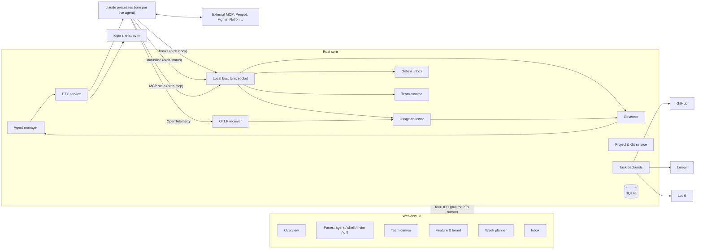

# Orchestrator — Product & Technical Specification

> Status: **Draft v0.6** · Owner: Guillaume · Last update: 2026-10-21
> v0.6 applies what building the headless agent runtime found (`crates/agent-runtime`, live runs with Claude Code 2.1.302 on 2026-10-21): sandbox rules for worktrees, the commit gap, kill and hook details, usage sampling, recovery.
> v0.3 applies the findings of the [P0 CLI spike](spikes/p0-claude-cli.md) (Claude Code 2.1.302). v0.4 applies the [P0 terminal spike](spikes/p0-terminal.md) (Tauri 2.12, xterm.js 6). v0.5 applies the [P0 recovery spike](spikes/p0-recovery.md).
> v0.2 applies the decisions and fixes from [the 2026-10-17 review](reviews/2026-10-17-spec-review.md). Main change: **agents are real Claude Code CLI processes** on the user's Max plan; there is no Agent SDK.
> Scope: *what* we build and *why*, plus the high-level *how*. Implementation choices are in the ADRs (`docs/adr/`).

---

## 1. Vision

Orchestrator is a **personal, local-first macOS app** for running software projects with AI agents. It is built **around the official Claude Code CLI** and adds what a solo developer juggling several projects is missing:

- one place for all **projects** (local folders plus their git and remote state),
- **solo sessions or whole teams of specialist agents** (lead, backend, frontend, UI, UX…) working in parallel, each isolated in its own git worktree,
- each agent is a **real Claude Code session in a terminal pane**, so the chat is Claude Code's own, next to a **terminal that looks like kitty** and **your own nvim**,
- **full visibility on usage** (5h and weekly plan limits, context, tokens) and **pacing**, the key differentiator: the app spreads agent work so the Max plan lasts the whole working week.

### 1.1 Goals
| # | Goal | Success measure |
|---|---|---|
| G1 | Manage many projects and see their git/remote/PR state at a glance. | Git state of every project visible in ≤ 1 screen. |
| G2 | Run many agent sessions in parallel, safely isolated. | Agents never write outside their worktree; no lost work. |
| G3 | Compose teams of agents **visually on a canvas** and let a lead agent coordinate them on a feature. | A feature delivered end to end by a team with 2 gates. |
| G4 | Talk to any agent with the full Claude Code experience. | 100 % of Claude Code's interactive features are available, because it *is* Claude Code. |
| G5 | Keep the developer's own tools: terminal rendered like kitty, nvim with their config. | Side-by-side screenshot: font, colors and spacing match kitty. |
| G6 | Monitor usage live and **pace all work against the 5h and weekly limits**. | No hard limit lockout during working hours; ≥ 85 % of the weekly allowance used by reset. |
| G7 | Integrate with the developer's PM/design stack: GitHub, Linear, Notion, Figma, Penpot. | Tasks and design links flow without copy/paste. |
| G8 | Keep the runtime replaceable (other agent CLIs later). | Provider interface with one implementation (Claude Code CLI). Priority: **C**. |
| G9 | A designed, consistent UI with a Penpot file as its source of truth. | P1 screens designed before they are built. |

### 1.2 Non-goals (for now)
- Multi-user collaboration, hosted service, accounts.
- **Rebuilding Claude Code's chat UI.** We embed the real CLI.
- **The Claude Agent SDK and API-key billing.** Max-plan usage only works through the official Claude Code client; API usage is billed separately (see ADR-002).
- A built-in code editor (the user's editor is used).
- Replacing GitHub/Linear: we sync with them.
- Windows/Linux in the first versions (macOS first, portable core).

---

## 2. Glossary

| Term | Definition |
|---|---|
| **Project** | A local directory registered in the app (usually a git repository). |
| **Feature** | A unit of product work in a project (e.g. "Checkout v2"). It owns docs, tasks, a team run and an integration branch. |
| **Agent** | One running **Claude Code CLI process** (`claude`) in a PTY, launched with a Role's configuration. |
| **Session** | The Claude Code conversation behind an Agent, identified by its Claude session id. It can be resumed after its process stops. |
| **Turn** | One unit of autonomous work the app hands to an agent (a task, a message, a "continue"). It is the unit the Governor admits. |
| **Role** | A reusable agent definition: prompt, model, effort, tools, MCP servers, permission profile, sandbox, budget priority. |
| **Team** | A graph of Roles (nodes) and relations (edges), authored on the canvas. |
| **Lead** | The team role that decomposes work, assigns tasks and integrates results. Exactly one per team. |
| **Task** | A unit of work assigned to a team node. Stored in the project's **task backend** (local / GitHub / Linear). |
| **Worktree** | A git worktree and branch dedicated to one agent, in the project's **sibling worktree folder**. |
| **Gate** | A decision only the user can make: spec approval, merge/PR, out-of-sandbox action, budget. |
| **Inbox** | The central queue of everything that needs the user, ordered by the attention ladder (§9.6). |
| **Governor** | The scheduler that admits, queues, pauses or defers agent work to respect the weekly plan. |
| **Weekly plan** | The user's budget for the current plan week: working calendar, allocations, reserve. |
| **Signal** | A usage figure observed from Claude Code (statusline `rate_limits`, context, cost; OpenTelemetry metrics; hook events). |

---

## 3. Persona & key user journeys

**Persona: Guillaume.** A senior developer working alone on several projects in parallel. Claude Max subscriber, lives in kitty and nvim, keyboard first, **8 GB laptop that is often under memory pressure**. Uses GitHub, Linear, Notion and Penpot/Figma. He wants leverage (many agents) without losing control (gates, his own tools) or running out of weekly limit.

### J0 — Onboarding (first run)
1. The app checks that `claude` is installed, that its version is in the supported range (NFR-7), and that it is logged in with a Pro/Max subscription. If not: instructions, and the app stays in read-only mode.
2. **Workspace trust**: Claude Code blocks the first launch in an untrusted folder with a trust dialog, before any hook runs. Trust is keyed by the **main repository root**: once the user trusts the project root, every worktree of that repository is trusted wherever it lives (P0 recovery spike). So for each project the app opens one pane in the project root for the user to answer the dialog. After the repo is moved, the dialog comes back once; the app detects it on the PTY ("Quick safety check"), shows that pane to the user, and never answers it itself. The dialog's default choice is "No, exit" (the user moves down to "Yes, I trust this folder"). No hook fires before it is answered, so the first SessionStart clears the detection (its text stays in the PTY output after it closes).
3. Add the first projects (J1). Import `kitty.conf` (fonts, colors). Pick the editor command (default `nvim`).
4. Set the first weekly plan (J8). If last week's data is missing, the app proposes an even split.

### J1 — Add a project and see its state
1. **Add project** (⌘N) → pick a folder or clone a URL.
2. The app detects git, the default branch and the remotes, then runs a background `git fetch`.
3. The project row in the Overview shows: branch, ahead/behind, dirty count, open PRs and CI, live agents, budget share and burn.

### J2 — Solo session in a worktree
1. From the project, **New session** (⌘T) → choose a role (or "plain Claude"), the base branch, and a worktree (default on).
2. The app creates branch `orch/solo/<slug>` and a worktree in the sibling folder, then starts `claude` in a pane in that worktree with the role's configuration (§6.3).
3. The user talks to Claude Code as usual. Paths in its output are clickable and open in nvim (J7). A shell pane can be split next to it (J6).
4. When done: **Create PR** (gate) or **Merge into base**, then the worktree is cleaned up.

### J3 — Team on a feature
1. Open the **Team canvas** and add *Lead*, *Backend*, *Frontend*, *UI*, *UX* from the library, with the mouse or keyboard (§9.7). Connect edges: reports-to Lead, UX → UI hands-off, Frontend reviews UI. The **Rules panel** shows the result as text ("Frontend can message: Lead, UI").
2. **Launch on feature** → pick or create a Feature and write a 3-line brief.
3. The app creates the integration branch `orch/<feature>/integration` and **the Lead's worktree on it**. The Lead drafts `spec.md`, `ux-brief.md` and `api-contract.md` in `.orchestrator/features/<slug>/` on that branch → **Spec gate** in the Inbox.
4. The user reviews (in nvim or the rendered view) and approves. The Lead creates tasks in the task backend and assigns them to team nodes.
5. The Governor starts specialists as budget and the live-agent cap allow. Each one runs in its own worktree branched from the integration branch. UI/UX roles use the Penpot/Figma MCP.
6. Specialists report through the orchestrator MCP tools. The Lead reviews and merges their branches into the integration branch; conflicts go back to the owning agent.
7. **PR gate**: the user reviews the integration diff and approves. The app opens the PR (agents can't push themselves, §6.5).

### J4 — Overview & monitoring
1. The **Overview** pane lists every agent across projects: state (§9.5), current tool, files touched, context %, usage this session, governor status, memory.
2. From the keyboard: open, interrupt, pause (stop at the next turn boundary), suspend, kill, resume.

### J5 — Inbox triage
1. The Inbox badge shows pending items ordered by the attention ladder: blocked agents first, by how long they have waited.
2. Each item shows who is asking, what, why, a preview (diff/command/spec), and the actions Approve `a` / Reject `r` / Reply `⏎` / Open `o`.
3. After approval the agent resumes. If the Governor queues it, the item says so, with an estimated start time.

### J6 — Terminal
1. **Open terminal** (leader `t`) → a pane with the user's login shell in the focused agent's worktree or the project root.
2. It renders like the user's kitty (font, colors, cursor, padding from `kitty.conf`). Splits, tabs and zoom are available. **Open in kitty** opens the real kitty at the same cwd.

### J7 — Edit in nvim
1. Click (or select with the keyboard) a file path in an agent pane, a diff or an Inbox preview → **Open in editor**.
2. nvim opens at the file and line, reusing the project's nvim pane if one is open. The user edits and saves.
3. The app detects the change. If the file belongs to an agent's worktree, the agent is told "the user edited `src/x.ts`" at its next turn.

### J8 — Pacing the week
1. When the weekly window resets, a **Week planner** item appears in the Inbox. Working days and hours, projects A 50 % / B 30 % / C 20 % and a 10 % reserve are prefilled from last week. The user adjusts and confirms.
2. The title bar shows both windows: *Week 41 % · plan 38 % (+3) · 5h 22 % · resets Mon 09:00*.
3. On Wednesday, usage is 9 pp over plan, so the Governor moves to **Red**. It caps live autonomous agents to 1, queues low-priority team tasks, and proposes in the Inbox to defer "Search v2" until after the reset. Every queued agent shows why and when it will start, with a **Run now** button that shows the cost ("≈ +2 pp").
4. On Friday, usage is 12 pp under plan with < 24 working hours left, so the Governor moves to **Catch-up** and releases queued work at higher concurrency.
5. The week ends at about 90–100 % used, near the reset. The weekly report summarizes usage per project, feature and role, plus the governor's actions.

### J9 — Plan limit reached anyway
1. Claude Code reports that a window is exhausted: a **StopFailure** hook with `error: "rate_limit"`, and the statusline jumps to `used_percentage: 100` with the reset time (a window the response doesn't report is *absent*, not 0).
2. The app marks all agents **Blocked by limit**, pauses autonomous work at the next turn boundary, and shows the reset time in a global banner.
3. At the reset the Governor resumes queued work in priority order. Nothing is lost: sessions are resumed by id. The CLI also arms **its own auto-continue at the reset** ("continuing automatically at …"). The app either counts that turn as admitted work or sends Esc to cancel it and reschedules the agent through the Governor (default: cancel and reschedule, so the Governor keeps control). A real limit hit is still untested (R10).

### J10 — Recovery
1. **Login expired**: a global banner appears and autonomous work is paused. The fix is one click: open a pane running `claude /login`.
2. **App crash or restart**: the core owns the agents' PTYs, so a core crash **ends every agent** within about 10 s (SIGHUP): `claude` kills its shells, records an interrupted tool as `Exit code 137`, and exits. Recovery is therefore **reconcile, then `--resume`**, never reattaching to live processes; resuming within the prompt-cache lifetime (1 h) is nearly free. The reconciler runs in this order:
   1. Replay the `orch-hook` spool (events recorded while the core was down).
   2. Reconcile worktrees: finish `creating` rows (worktree creation = add + lock + DB row, each step idempotent), and report unknown or missing worktrees.
   3. Detect half-done git operations (`MERGE_HEAD`, `REBASE_HEAD`, `rebase-*`, `CHERRY_PICK_HEAD`, `REVERT_HEAD`, unmerged paths): **flag and suspend** the agent and create an Inbox item.
   4. Remove a stale `index.lock` only when no git process runs in that worktree.
   5. Kill leftover processes by process group, argv and **cwd inside the worktree** (FR-207).
   6. Read each transcript by session id and decide: resume, suspend or flag. App-delivered turns carry a **turn id marker** that the reconciler finds in the transcript, so no turn is delivered twice. A resume is recorded as a queued resume turn, so it survives another crash before it happens; a suspended agent with queued work is resumed through the Governor (FR-403).
   7. Open gates come back as pending Inbox items; governor holds are requeued.

   Programs the user ran in shell panes are restarted in their cwd only; their state is lost (NFR-2). The resume message asks the agent to check what an interrupted command already did before redoing it.
3. **Laptop asleep** during off-hours work: nothing runs while the machine sleeps. When off-hours work is queued, the app asks to keep the machine awake on AC power (macOS power assertion) and shows a warning if it isn't on AC.

### J11 — Remove a project
1. **Remove project** → the app lists its worktrees, branches and running agents, and offers to stop agents, delete merged worktrees and keep unmerged ones (never deleted silently).
2. Settings and history are deleted or archived, as the user chooses. `.orchestrator/` in the repo is left untouched.

---

## 4. Functional requirements

Priority: **M** must, **S** should, **C** could. Phases are listed in §11. Journeys are in brackets.

### 4.1 Projects & Git
| ID | Requirement | P |
|---|---|---|
| FR-101 | Register a local folder as a project; clone from a URL. [J1] | M |
| FR-102 | Show the branch, ahead/behind upstream, dirty/staged/untracked counts, last commit and stash count. [J1] | M |
| FR-103 | Run `git fetch` periodically and on demand, only for projects active in the last 7 days. The interval is configurable; fetching pauses on battery below 20 % and when offline. [J1] | M |
| FR-104 | List branches and worktrees, including orphaned ones, with one-click cleanup. Unmerged work is never deleted without explicit confirmation. [J11] | M |
| FR-105 | Worktree lifecycle (ADR-003): created in the **sibling folder** `<parent>/<repo>.worktrees/` with `worktree.useRelativePaths=true` (so moving the repo and its sibling folder together needs no repair; needs git ≥ 2.48, checked at start), `git worktree lock`ed while in use, and cleaned up on completion. Creation is add + lock + DB row, each step idempotent. Branch names: `orch/solo/<slug>`, `orch/<feature>/integration`, `orch/<feature>/<role>-<n>`. [J2, J3] | M |
| FR-106 | Show the project's GitHub PRs and CI checks (via `gh`). [J1] | S |
| FR-107 | Diff viewer per worktree (against base or the integration branch) and file tree with change markers. | M |
| FR-108 | Merge/rebase helpers with conflict detection; conflicts can be handed to the owning agent. | S |
| FR-109 | Per-project settings: default base branch, task backend, default team, budget share, setup script run on worktree creation, whether `.orchestrator/` is tracked in the repo (default) or kept in app data. | M |
| FR-110 | **Setup script safety**: copying `.env` or other secrets into worktrees is opt-in, with a warning that agents will read them and send them to the model. | M |
| FR-111 | Remove a project with the guided cleanup of J11. | M |

### 4.2 Agent sessions (Claude Code in a pane)
| ID | Requirement | P |
|---|---|---|
| FR-201 | An agent is the **real `claude` CLI** running interactively in a PTY pane, with a per-agent configuration generated from its role (§6.3). The user interacts with it directly: Claude Code's full UI (slash commands, plan mode, `!`/`#`, vim mode, rewind, subagents…) is available as is. [J2] | M |
| FR-202 | Create, resume (`claude --resume <id>`), fork, rename and archive sessions. Sessions survive app restarts. | M |
| FR-203 | **Live agents vs queued work**: any number of sessions can exist, but the number of live `claude` processes is capped: **default 3** (about 190–255 MB each, measured in P0; 3 agents ≈ 0.6 GB). The cap also **drops when macOS reports memory pressure** and recovers when it ends. Extra work waits in the Governor's queue. | M |
| FR-204 | **Suspend/resume**: an agent idle for N minutes (configurable, default 10) or waiting at a gate is stopped and later resumed with `--resume <id>` (verified in P0, including after a kill mid-tool). Resuming within the prompt-cache lifetime (1 h observed, read from the statusline `prompt_cache.expires_at`) costs almost nothing; later resumes re-pay the context and are counted by the Governor. The UI shows "Suspended" and resumes on focus or on new work. | M |
| FR-205 | Agent metadata pulled from Claude Code (§6.4): model, context %, cost/usage, current tool, last activity, state. It is shown in the pane header, the sidebar and the Overview. | M |
| FR-206 | **Programmatic input** for orchestration: the app can deliver a message or a "continue" to an idle agent (PTY bracketed paste), and add context to a busy one (hook `additionalContext`, §6.4). The user's own typing always wins over the app's. **Delivery rules** (from P0): start a message that begins with `/`, `!` or `#` with a space (otherwise the CLI runs it as a command and no turn starts); keep pastes under 900 characters (longer pastes are wrapped as untrusted `<pasted_content>`), and put longer instructions in a file under the agent's folder with a short message pointing to it; don't rely on tabs; wait 1.5 s after SessionStart before the first input. Input sent during a turn is queued by the CLI, not lost. | M |
| FR-207 | **Interrupt** (Esc sent to the PTY), **pause** (no new turns delivered), **kill**: SIGTERM to `claude`'s process group **and** to the group of every process with no controlling terminal whose cwd is inside the agent's worktree (`lsof -d cwd`), then SIGKILL after 5 s. A process with its own terminal and another group (the user's shell `cd`'d into the worktree) is not the agent's and is left alone. The process group alone isn't enough: Claude's Bash tool runs each command in its own session, and `cmd &` children outlive `claude` (P0). The agent id in the environment can't be used to find them (macOS hides the environment of system binaries). PTY master file descriptors are close-on-exec, so a leaked one can't keep a headless `claude` alive. | M |
| FR-208 | Clickable file paths and URLs in agent and shell panes (open in editor or browser). | M |
| FR-209 | Search across session transcripts (Claude Code's JSONL files), per project or global. Transcripts are found **by session id** across `~/.claude/projects/*/`: after a repo move, a resumed session keeps writing to the transcript in the old project folder. | S |
| FR-210 | macOS notifications follow the attention ladder (§9.6), never one per finished turn. | M |

### 4.3 Agent & team builder (visual canvas)
| ID | Requirement | P |
|---|---|---|
| FR-301 | **The canvas is the main editor** for teams: add, move and connect nodes, zoom and pan, auto-layout, undo/redo, minimap. Sized for 3–10 nodes. [J3] | M |
| FR-302 | **Full keyboard operation of the canvas**: add a node from the library (`n`), move the selection between nodes (arrows/hjkl), connect (`c` then the target and the edge type), delete, open the inspector (`⏎`). | M |
| FR-303 | Node = a Role configuration in the inspector: name, icon/color, prompt (markdown, can be opened in nvim), model, effort, allowed tools, MCP servers, permission profile, sandbox profile, max concurrency, budget priority. | M |
| FR-304 | Edge types and their meaning: **reports-to** (A → B: A sends reports to B, B can assign tasks to A), **hands-off-to** (A → B: A can send artifacts to B), **reviews** (A → B: A can request reviews from B and B can reply), **can-message** (both ways). The Lead can always message every node. | M |
| FR-305 | **Rules panel**: a text view of the resulting permissions ("Frontend can message Lead, UI; can request review from Reviewer"). Validation errors are shown inline (no lead, unreachable node, cycle of reports-to). | M |
| FR-306 | Library of reusable Roles and Team presets (global or per project): duplicate and version them. Starter presets: *Solo dev*, *Full-stack feature team*, *Bugfix squad*, *Design sprint*. | M |
| FR-307 | Import/export teams and roles as JSON. | S |
| FR-308 | At launch, a team is **compiled** into per-agent Claude Code configurations (§6.3). The compiled files can be inspected read-only, and a TeamRun keeps a snapshot of the team version it used. | M |

### 4.4 Orchestration runtime
| ID | Requirement | P |
|---|---|---|
| FR-401 | Lead protocol: *understand → spec → (spec gate) → decompose → assign → track → review → integrate → (PR gate)*. It is written into the Lead's prompt and enforced by tool availability. [J3] | M |
| FR-402 | **Orchestrator MCP server** (stdio, one per agent, ADR-002) with the tools `send_message(to, body)`, `inbox()`, `create_task`, `update_task(status, notes)`, `list_tasks`, `handoff(artifact, to)`, `request_review(branch, to)`, `ask_user(question, options)`, `report_done(summary)`. Recipients are checked against the team graph on the server side. | M |
| FR-403 | **Message delivery without polling**: for a busy agent, messages are injected at its next tool call (PostToolUse `additionalContext`: "2 new messages from Lead"). For an idle agent, a new turn is delivered via the Governor. A suspended agent is resumed through the Governor first. | M |
| FR-404 | Task dependencies (blocked-by): an agent is only given a task once its dependencies are done. | M |
| FR-405 | The Lead owns the integration worktree and does all merges into it; specialists never merge. Conflicts are routed back to the owning agent. | M |
| FR-406 | Team controls: pause, resume or stop the whole team; restart one agent; reassign a task; add a node mid-run. | M |
| FR-407 | Watchdog: a turn exceeding its ceiling (usage or duration, set per role) is interrupted at the next tool boundary, and an Inbox item is created. An agent with no progress for 15 min creates an Inbox item. | M |
| FR-408 | Team activity timeline: messages, task changes, merges, gates, governor actions; filterable. | M |
| FR-409 | The user can message the Lead or any agent directly (in its pane, or through the team timeline). | M |
| FR-410 | **Subagents and background work**: Claude Code's Agent tool runs subagents **asynchronously by default**, and background shells too; when they finish they start a **new turn by themselves** (a `<task-notification>` prompt). These turns don't come from the app, so the Governor counts them (they still pass PreToolUse admission), and a role can disallow background Bash and async subagents (exact switch to confirm, R10). Subagent usage is attributed to the agent through SubagentStart/SubagentStop (`agent_id`, `agent_type`, transcript path) and the notification's `subagent_tokens`. | M |

### 4.5 Tasks & project management
| ID | Requirement | P |
|---|---|---|
| FR-501 | Task backend abstraction (ADR-004): **Local** (app DB), **GitHub Issues**, **Linear**. Chosen per project. | M (Local, GitHub) / S (Linear) |
| FR-502 | Board view (Backlog / Ready / In progress / Review / Done), the same over every backend. | M |
| FR-503 | Two-way sync with GitHub/Linear (status, assignee label, comments). On conflict the remote wins and the user is notified. | S |
| FR-504 | Feature docs in `.orchestrator/features/<slug>/` (`spec.md`, `ux-brief.md`, `api-contract.md`, `decisions.md`). **The source of truth is the copy on the integration branch**, edited in the Lead's worktree; the Feature page always opens that copy. | M |
| FR-505 | Notion: publish a feature's docs to a page and refresh it; bring comments back as Inbox items. | C |
| FR-506 | Links between tasks, branches, PRs and sessions, so every artifact can be reached from the others. | M |

### 4.6 Design tooling
| ID | Requirement | P |
|---|---|---|
| FR-601 | UI/UX roles can be given the **Penpot MCP** and/or **Figma MCP** in the builder. | M |
| FR-602 | Design artifacts (file/frame links, exported images) are attached to the feature page and handed off to frontend roles. | S |
| FR-603 | Preview of exported frames on the feature page. | C |
| FR-604 | MCP auth status per server; missing auth becomes an Inbox item, never a silent failure. | M |

### 4.7 Gates, permissions, sandbox & Inbox
| ID | Requirement | P |
|---|---|---|
| FR-701 | Default autonomy is **"gates at key points"**: inside its worktree an agent edits files and runs commands freely, within its sandbox. | M |
| FR-702 | **Enforced sandbox** (ADR-009): Claude Code's OS-level sandbox for Bash, with writes limited to the agent's worktree (plus the CLI's scratch folder and caches), **reads denied** for credential stores, the main checkout and the other worktrees, and network limited to an allow-list. Claude's Read/Edit/Write tools are not covered by the OS sandbox, so permission rules (absolute paths written `//…`) deny the same places. The main checkout is denied **entry by entry, except its `.git`**: the CLI drops an `allowWrite` that lies under a `denyRead` path, and the worktree's git needs the repository's git dir (`allowRead` and `allowWrite` on it). Sandbox paths are plain absolute paths; only permission rules use `//`. **Known gap (2026-10-21, 2.1.302)**: sandboxed Bash still cannot write the repository's git dir from a linked worktree (`index.lock` denied), so agents can't commit; until this is fixed the core commits for them (R10). | M |
| FR-703 | **No credentials for agents**: credential env vars and `SSH_AUTH_SOCK` are removed; credential files on disk (`~/.ssh`, `~/.config/gh`, `~/.netrc`, `~/.git-credentials`, cloud CLIs…) are unreadable inside the sandbox; git uses a generated global config with no credential helper (`GIT_CONFIG_GLOBAL`, `GIT_TERMINAL_PROMPT=0`). Removing env vars alone is not enough: in P0 the SSH key and the `gh` keyring token still reached GitHub. `git push`, PR creation and merges to protected branches are only possible through gated orchestrator MCP tools. | M |
| FR-704 | Gate types: **Spec approval**, **Merge/PR**, **Out-of-sandbox action**, **Budget** (governor "ask"). Gates are implemented with **PreToolUse hooks** (they also run for allow-listed tools) and the orchestrator MCP tools. | M |
| FR-705 | **Gates and permission prompts**: a short decision (a permission prompt, a quick gate) is answered from the Inbox through the **PermissionRequest hook** without ending the turn, while `orch-hook` holds it within its own deadline. Long holds work (200 s under a 600 s timeout in P0, with the pane still usable), so ending the turn for a long wait is a **memory** choice: the hook denies with "awaiting user approval", the turn ends, and the agent can be suspended; on approval the app resumes it and delivers "approved: proceed". While it holds a hook, the core **watches the connection**: Esc in the pane kills `orch-hook` and no hook event reports it, so on EOF the Inbox item is closed as "interrupted by the user". | M |
| FR-706 | Permission profiles (strict / gated / autonomous) per role, overridable per session. | M |
| FR-707 | Inbox: one list ordered by the attention ladder (§9.6), with filters (project, type, agent) and keyboard triage (`j/k` move, `a` approve, `r` reject, `⏎` reply, `o` open, `x` select for batch, `u` undo for 5 s). Items whose context has changed are marked **stale**. | M |
| FR-708 | "Always allow this for this project/role" creates a scoped rule that is visible and revocable in settings. | S |
| FR-709 | Every gate decision and permission change is logged. | M |

### 4.8 Usage pacing & budgets (core)
The control law is specified in **ADR-007**. The requirements below are what the user sees.

| ID | Requirement | P |
|---|---|---|
| FR-801 | **Usage collector**: record the plan-limit signals from Claude Code (statusline `rate_limits.five_hour` / `seven_day` used % and reset times, StopFailure `rate_limit` errors) and per-session usage (OpenTelemetry token/cost metrics, statusline cost and context), attributed to agent, role, team, feature and project. Each sample records where its value came from (*observed* or *estimated*). Statusline `rate_limits` are **per-process copies of that agent's last API response**, so for each window the collector uses the **most recent sample across all agents** (by sample time), and treats a missing window as unknown, not 0. A statusline re-render carries no response time: a sample counts as a **new response** only when its readings or its cost changed, and is timed when the core receives it (idle re-renders are dropped). The first response's sample can arrive up to `refreshInterval` (5 s) after its Stop. | M |
| FR-802 | **Weekly plan**, aligned to the weekly reset (`rate_limits.seven_day.resets_at`; the plan week moves when a reading shows another reset): working calendar (days, hours, time zone, holidays), allocations per project/feature/team as **weights**, a priority tier (critical / high / normal / low), and a **reserve** for interactive work. Prefilled from last week. [J8] | M |
| FR-803 | **Ideal curve**: `ideal(t)` = fraction of the week's weighted working hours elapsed at time t × (100 % − reserve − forecast unattributed usage). Off-hours count only if the user enables an off-hours allowance. | M |
| FR-804 | **Pressure states** with hysteresis: **Green / Amber / Red / Catch-up**, computed from the error `e = used − ideal` (pp) and the projected exhaustion time. Thresholds are in ADR-007 and adjustable in settings. | M |
| FR-805 | **Governor v1 actions**: cap live autonomous agents per state; queue new turns by priority; pause teams at the next turn boundary; propose to defer work until after the reset; a separate **5h guard** that keeps headroom for interactive work. | M |
| FR-806 | **Admission points**: the Governor decides at **turn start** (for turns the app delivers; self-started turns from background work are counted, FR-410) and at **each tool call** (a PreToolUse hook waits up to a few seconds for admission, then denies with "paused by governor" if it is still held). Parallel tool calls run their hooks concurrently, and each one is admitted separately. The user's own typing in a pane is never blocked. **`orch-hook` fails closed for tools**: hook timeouts, crashes and a missing hook binary all let the tool run, so `orch-hook` always answers itself. If the core's socket is missing, refused, closes mid-hold, or misses `orch-hook`'s deadline, PreToolUse and PermissionRequest answer **deny** ("ORCH: orchestrator unavailable"); every other event exits 0 at once and is **spooled** to the agent's folder for replay. It never exits with code 2 on non-tool events (that blocks and erases the user's prompt), and only PreToolUse/PermissionRequest wait on the core; the others wait at most 1 s for the connection **and** the reply together, so a hung core never delays a prompt by more than a second. An admitted tool call gets **no decision** from the hook (not `allow`), so the agent's own permission prompts still apply. | M |
| FR-807 | **Interactive and critical work** is admitted first and draws from the reserve. When the reserve is used up, the app warns instead of blocking and squeezes the other work harder. If most usage is interactive, the Governor has little to act on; the planner says so. | M |
| FR-808 | **Fair scheduling**: queued work is picked by weighted fair queuing over allocation weights, with priority tiers and **aging** (one tier up for every 2 h of waiting) so nothing starves. Unused weight is redistributed. Nothing rolls over to the next week. | M |
| FR-809 | **Transparency**: every queued or paused agent shows why, its estimated start, and **Run now** with its estimated cost. Every governor action is logged with its reason and can be undone from the log. A **next-action preview** shows what the Governor would do next. | M |
| FR-810 | **"Ask" actions** come with a default and a timeout (default: apply after 20 min), so they never stall when the user is away. | M |
| FR-811 | **Overrides**: Sprint mode (borrow budget: today's target goes up and the remaining days go down, and the trade-off is shown), hard caps per allocation, **Pause all** / **Resume**. | M |
| FR-812 | **Shadow mode**: the Governor can log its decisions without enforcing them (default on for the first week). | M |
| FR-813 | **Unattributed usage** (the user's Claude usage outside the app: claude.ai, mobile, other terminals) = observed weekly % − the app's own attributed share. It is forecast as its own rate, subtracted from the agents' budget, and shown as "outside the app". | M |
| FR-814 | **Estimator fallback**: if the observed % is not available (e.g. before the first response of the week), the weekly % is estimated from usage with one calibrated scalar and a safety margin (10–15 pp), marked with a confidence indicator. | S |
| FR-815 | **Per-model weekly limits**: if the plan has a separate weekly limit for some models, it is tracked as an extra window, and those models are avoided automatically when that window is under pressure. | S |
| FR-816 | Off-hours scheduling: queue long work for configured windows, inside the plan's limits; requires AC power and a power assertion (J10). Allowed by the R1 decision. | S |
| FR-817 | Alerts: 50 / 75 / 90 % of the week, entering Red, 5h guard active, limit reached (J9). | M |
| FR-818 | Weekly report: usage per project/feature/role/model, governor actions, plan versus actual. | S |
| FR-819 | **Model downgrade** is manual or opt-in per role, applied only at a task boundary, never to the Lead or reviewers by default. (Switching models breaks the prompt cache and can cost quality.) | C |
| FR-820 | **Pacing simulator**: replay a recorded or synthetic week against the policy, for testing and tuning (acceptance tests in §5). | M |

### 4.9 Overview & monitoring
| ID | Requirement | P |
|---|---|---|
| FR-901 | Overview pane: every agent with live state (§9.5), current tool, files touched, elapsed time, context %, usage, governor status, process memory; grouped by project or by state. [J4] | M |
| FR-902 | Usage charts by project, feature, team, role, model and day. | S |
| FR-903 | Actions from the Overview: open, interrupt, pause, suspend, resume, kill. | M |
| FR-904 | The app's own memory (Tauri + webview processes + each `claude` process), with a warning threshold. | M |

### 4.10 Terminal
| ID | Requirement | P |
|---|---|---|
| FR-1001 | Terminal panes on a real PTY running the user's **login shell** with their env and dotfiles. [J6] | M |
| FR-1002 | **Renders like kitty**: font family/size, line height, colors, cursor style, padding and opacity imported from `kitty.conf` (following `include`s; unmapped options are listed), truecolor, Nerd Font symbols, ligatures only if kitty has them enabled. How (P0, ADR-006): (a) resolve `font_family` **the way kitty does** (exact monospace family, otherwise Menlo) and warn when kitty itself can't resolve the configured font; (b) the core loads the font files for the UI, because WKWebView hides user-installed fonts; (c) kitty's bundled `SymbolsNerdFontMono` is the symbol fallback; (d) cell width rounds up and line height comes from CoreText metrics, like kitty. **Acceptance**: side-by-side screenshots against what kitty *actually* renders (`kitty --debug-font-fallback`), not what `kitty.conf` says. | M |
| FR-1003 | Tabs, splits and zoom; the cwd defaults to the focused agent's worktree or the project root; scrollback is capped in memory, with older output spilled to disk. | M |
| FR-1004 | **Open in kitty** at the same cwd, using `kitty @ launch --cwd` when `kitty.conf` enables remote control (`allow_remote_control`, `listen_on`), otherwise a new kitty instance. | S |
| FR-1005 | **Renderer policy** (P0 memory, NFR-1b): the **DOM renderer is the default**. The first WebGL pane costs about 110 MB in WebKit's GPU helper, against about 10–15 MB per pane for the DOM renderer. WebGL is opt-in (setting), and even then at most 12 visible panes use it. Hidden panes always drop their WebGL context and keep only their buffer. WebKit allows 16 live WebGL contexts per page, and a lost context falls back to the DOM renderer. P1 confirms that the DOM renderer holds NFR-1 under heavy output; if it doesn't, the focused pane may switch to WebGL. | M |

### 4.11 Editor integration
| ID | Requirement | P |
|---|---|---|
| FR-1101 | **Open in editor** on file paths in panes, diffs, Inbox previews and task artifacts. [J7] | M |
| FR-1102 | The editor command template defaults to `nvim +{line} {file}` (or the `editor` set in `kitty.conf`), run in an embedded pane. If the project already has an nvim pane, the file opens there (`nvim --server <sock> --remote`). An external kitty window is optional. | M |
| FR-1103 | File changes are detected in worktrees. User edits appear in the timeline and are announced to the owning agent at its next turn. | S |
| FR-1104 | No built-in code editor; the only text editing in the app is for short fields (brief, replies). | M |

### 4.12 Settings
| ID | Requirement | P |
|---|---|---|
| FR-1201 | Claude Code: path to `claude`, supported version range (checked at every spawn), login status. Agents run with `DISABLE_AUTOUPDATER=1` (in P0 the CLI replaced its own binary mid-session); Claude Code updates are applied by the user, and the contract tests (R2) run after each one. The helper binaries (`orch-hook`, `orch-status`, `orch-mcp`) are installed at a **stable path in app data** (not inside the `.app` bundle, which moves and updates), and checked to exist and be executable at every spawn: a missing hook command fails open. The app never sets `ANTHROPIC_API_KEY`, and warns if it finds one in the environment (it would bill the API instead of the plan). | M |
| FR-1202 | MCP server registry (reused across roles) with per-project overrides. | M |
| FR-1203 | Integrations: GitHub (`gh` auth), Linear, Notion, Penpot, Figma, each with status and reconnect. | M (GitHub) / S (others) |
| FR-1204 | **Keyboard contract** (§9.7) with configurable bindings and a conflict checker that also reads the macOS system shortcuts (`com.apple.symbolichotkeys`, e.g. input-source switching). | M |
| FR-1205 | Theme: see §9.1 for precedence. | S |
| FR-1206 | The app never writes to the user's Claude Code configuration (`~/.claude`, `~/.claude.json`). All agents share it, because a separate config dir (`CLAUDE_CONFIG_DIR`) loses the login; Claude Code itself writes transcripts, history and trust there, and the app only reads them. Each agent gets an extra per-agent settings layer (§6.3). | M |

---

## 5. Non-functional requirements & acceptance tests

| ID | Category | Requirement (testable) |
|---|---|---|
| NFR-1 | Responsiveness | UI input-to-paint < 100 ms at p95 with 4 live agents, 6 terminals and 200 queued items; transcripts and lists virtualized. PTY output uses the **pull transport** (ADR-001): with 6 panes streaming, P0 measured frames at p95 35 ms / max 50 ms, against 2–5 s UI stalls with Tauri Channels. |
| NFR-1b | **Memory (primary constraint)** | Measured as **phys_footprint** (RSS is misleading under memory pressure: 66–315 MB for the same process in P0). App (Tauri + WebContent/GPU/Network helpers + Rust core) ≤ 250 MB with nothing running; **measured in P0: about 75 MB idle**, 88 MB with 1 DOM pane, 104 MB with 6 DOM panes (with WebGL: about 220 MB with 1 pane, 240 MB with 6). Test: 6 panes after heavy output ≤ 400 MB. The app's memory display counts the GPU helper. Measure with the screen unlocked and the window visible (WKWebView throttles otherwise). Each shell outside the app ≈ 5 MB. Each live agent ≈ 250 MB (P0: 165–210 MB idle, 230–255 MB working; 189–206 MB with `--strict-mcp-config`, which saves about 25 MB; 3 agents ≈ 0.6 GB). Runtime measurements (2026-10-21, haiku, `--strict-mcp-config`, about 26 % free RAM): 189–200 MB idle, 207–216 MB working, 204–210 MB after a resume. Default cap 3 live agents, lowered under memory pressure (FR-203). |
| NFR-2 | Resilience | After a crash every agent has exited (the core owns their PTYs); every session can be resumed by id, queues and plans are intact, worktrees reconciled (J10 reconciler). **Not guaranteed**: programs running inside shell panes (restarted in their cwd only), and an interrupted **non-idempotent** command can leave its partial effect twice after a resume (the resume message asks the agent to check first). App-delivered turns are never delivered twice (turn id markers). Test: kill -9 the app with agents idle, mid-tool, held in a gate and mid-merge, restart, and check nothing is lost or delivered twice (passed in the P0 recovery spike). |
| NFR-3 | Security | Sandbox and credential rules of FR-702/703. Orchestrator MCP traffic goes over a Unix socket with 0600 permissions, with no network port; its path stays under macOS's 104-byte limit (checked at start) and a stale socket file is removed at start. Secrets only in the macOS Keychain. Test (ADR-009): an agent prompted to write outside its worktree, read another worktree or a credential file, `curl` an unlisted host, `ssh -T git@github.com`, `gh api user` or `git push` (directly or inside a script) must fail. |
| NFR-4 | Privacy | Local-first; no telemetry. OpenTelemetry from Claude Code is exported only to the app's local receiver. |
| NFR-5 | Observability | Structured logs per agent; a debug pane with raw hook, statusline and OTEL events. |
| NFR-6 | Portability | macOS (Apple Silicon) first; no macOS-only APIs in the core except behind interfaces (power assertion, notifications, Keychain). |
| NFR-7 | Compatibility | A supported Claude Code version range is declared (P0 baseline: 2.1.302); the app checks it at every spawn and refuses or warns on untested versions (hooks, flags and statusline formats can change). Auto-update is disabled for agents (FR-1201). The contract tests include a missing hook binary (must not let tools run) and a hook with the core down. git ≥ 2.48 is required (relative worktree paths). |
| NFR-8 | Data | SQLite (WAL, one writer thread) in app data, with versioned migrations; large outputs stored outside the rows; retention for raw events (default 30 days). |
| NFR-9 | Pacing quality | In the simulator (FR-820): with a synthetic week whose demand is 130 % of the allowance, the policy never hits 100 % before the reset during working hours and ends between 85 and 100 %; with 60 % demand it never queues work. |
| NFR-10 | Compliance | Agents only use the official Claude Code client logged in with the user's subscription, with no API key. Automatic and unattended runs (several agents, off-hours, FR-816) are allowed, always inside the plan's 5h and weekly limits, which the Governor enforces (R1 decision, §10). The binary is never modified and the app never handles Claude credentials. |

---

## 6. Architecture

Stack (ADR-001): **Tauri 2** shell (system webview), a light UI framework (**Svelte 5**, picked in P0), a **Rust core**, and **`claude` CLI processes** spawned directly by the core in PTYs. There is no Node runtime.



### 6.1 Principles
1. **Claude Code is the agent runtime.** The app never re-implements the agent loop or the chat. It **configures** each `claude` process, **observes** it (hooks, statusline, OTEL, transcripts) and **steers** it (turn delivery, hook decisions, MCP tools, PTY input).
2. **The Governor controls every autonomous turn.** Autonomous work only starts when the app delivers it, and PreToolUse hooks give it a pause point at every tool call. Interactive typing is never blocked.
3. **Agents coordinate only through the orchestrator MCP server**, which enforces the team graph.
4. **Git is the integration medium**: work happens on branches and worktrees; artifacts are files in `.orchestrator/`.
5. **Small helper binaries** (`orch-hook`, `orch-status`, `orch-mcp`, shipped with the app) connect each `claude` process to the core over a Unix socket. The agent's identity comes from the environment the core sets when it spawns the process.

### 6.2 Agent lifecycle
`created → (governor admits) → working ⇄ waiting_for_you | waiting_gate | queued | blocked_by_limit → idle → suspended (process stopped, resumable) → archived`, plus `error` and `killed`. A Stop with a non-empty `background_tasks` is **not idle**: background work is still running and will start a new turn by itself. The mapping to UI labels is in §9.5.

Team run: `draft → spec → spec_gate → planning → executing → integrating → pr_gate → done`, plus `paused`, `deferred` and `failed`.

### 6.3 How an agent is configured (compiled from its Role)
For each agent the core writes a per-agent directory in app data and launches `claude` in the worktree. Flags verified in P0 (Claude Code 2.1.302):
- `--settings <file>`: the per-agent settings layer (loaded on top of the user's settings; its `statusLine` replaces the user's).
- `--mcp-config <file>` and, when the role says so, `--strict-mcp-config` (ignore the user's other MCP servers; also saves memory).
- `--setting-sources` when the role should not load the project's or the user's settings.
- `--model`, `--effort`, `--append-system-prompt`, `-n/--name`.
- `--session-id <uuid>` on first start, `--resume <id>` afterwards (`--fork-session` to fork).
- `--permission-mode` **always passed explicitly**, one of `manual | acceptEdits | auto | dontAsk | plan` (`bypassPermissions` never). Otherwise the user's own `defaultMode` applies to agents.
- **Never** `--bare` or `--safe-mode`: both disable hooks, including the app's.

The generated settings contain:
- **hooks** → `orch-hook` for SessionStart, UserPromptSubmit, PreToolUse, PermissionRequest, PostToolUse, PostToolUseFailure, PostToolBatch, Notification, Stop, StopFailure, SubagentStart/SubagentStop, PreCompact and SessionEnd, each with a generous `timeout` (600 s) that `orch-hook` never reaches (FR-806);
- **statusLine** → `orch-status` with `refreshInterval: 5` so idle agents keep reporting; it forwards the JSON to the core and then runs the user's own statusline command, if any, and prints its output;
- **sandbox** and **permissions** from the role's profiles (FR-702, ADR-009);
- **environment**: built from scratch (not inherited from the app), with PATH taken from the user's login shell (user plugin hooks need tools like `node`), the agent id and socket path, `DISABLE_AUTOUPDATER=1`, OpenTelemetry to the local receiver tagged with `OTEL_RESOURCE_ATTRIBUTES=orch.agent_id=<id>`, the generated git config, and no credentials (FR-703).

**Orchestrator preamble**: every compiled prompt includes a short `--append-system-prompt` section saying that text starting with `ORCH:` in hook context comes from the orchestrator on the user's behalf. Without it, the model treats hook context as untrusted and ignores it (seen in P0).

User customizations still load into every agent (CLAUDE.md, skills, plugins and their hooks, claude.ai connectors, user MCP servers, permissions) unless the role turns them off with `--strict-mcp-config` / `--setting-sources`.

### 6.4 Signals and control channels (verified in P0 unless marked)
| Need | Channel |
|---|---|
| 5h / weekly %, reset times, context %, cost, prompt-cache state | statusline JSON via `orch-status`: `rate_limits.five_hour/seven_day.{used_percentage, resets_at}` (integer %, epoch s), `context_window`, `cost`, `prompt_cache` (`ttl`, `expires_at`, `recache_tokens_if_cold`). Missing until the first API response of a session. |
| Tokens and cost over time per session | OpenTelemetry (OTLP http/json, local only): metrics `claude_code.token.usage`, `cost.usage`, `active_time.total`, `session.count`…; events `api_request` (tokens, cache, cost, duration), `tool_result`, `tool_decision`. Records include the user's email and account ids, so the receiver stays on localhost. No rate-limit data here. |
| State (working, waiting, idle, finished) | Hooks: UserPromptSubmit, PreToolUse, Stop, Notification (`permission_prompt`, `idle_prompt` ~60 s after Stop), SessionStart (`startup`/`resume`), SessionEnd. Nothing fires on SIGKILL. UserPromptSubmit **also fires for a message queued during a turn**, with the running turn's `prompt_id`: same `prompt_id` = not a new turn. Stop with a non-empty `background_tasks` is not idle (§6.2). SubagentStop with an empty `agent_type` and no SubagentStart (internal helpers, compaction) carries no state. SessionEnd `reason` is `other` both on crash and on suspend, so the core uses its own intent. |
| Tool admission | PreToolUse decision `allow` / `deny` with a reason. Deny rules in permissions win over a hook's `allow`. When the Governor admits a call the hook answers nothing, so the CLI's own permission flow still applies; it denies with "paused by governor" after holding a few seconds. |
| Permission prompts and short gates | **PermissionRequest** hook answering `allow`/`deny` (no dialog shown). |
| Audit of rule-denied calls | **PostToolBatch** (calls denied by permission rules reach neither PreToolUse nor PermissionDenied). Sandbox violations only appear in tool output. |
| API / rate-limit errors | **StopFailure** hook (verified): `error` = `rate_limit` or `model_not_found`, with `last_assistant_message`; no Stop follows. On a plan-limit 429 the statusline shows `used_percentage: 100` and the CLI arms its own auto-continue at the reset (J9). |
| Inject messages into a busy agent | PostToolUse `additionalContext`, prefixed `ORCH:` (needs the preamble above). |
| Deliver a new turn to an idle agent | PTY bracketed paste + Enter while idle and the user isn't typing, following the FR-206 delivery rules. |
| Keep an agent working on queued tasks | Stop hook returning `{"decision":"block","reason":"<next task>"}` if the Governor admits it; never when the payload has `stop_hook_active: true` and nothing new was admitted (avoids loops). |
| History and search | Claude Code's transcript JSONL (`transcript_path` in every hook payload). |

The contract test suite (R2) replays these checks after every Claude Code update.

### 6.5 Security model (ADR-009)
Per-agent OS sandbox for Bash, permission rules for Claude's own tools, no credentials, push and PR only through gated MCP tools, and an audit log of every gate and permission decision.

---

## 7. Data model (first cut)

| Entity | Main fields |
|---|---|
| Project | id, name, path, defaultBranch, remotes, worktreeRoot, taskBackend {type, config}, trackOrchestratorDir, settings |
| Feature | id, projectId, slug, title, status, integrationBranch, integrationWorktreeId, priority, allocationId |
| Role | id, scope, name, icon, prompt, model, effort, tools, mcpServers, permissionProfile, sandboxProfile, turnCeiling, subagentsAllowed, budgetPriority, version |
| Team | id, scope, name, nodes[], edges[], settings, version |
| AgentNode | id, teamId, roleId, overrides, position, maxConcurrency, isLead |
| Edge | id, teamId, from, to, type |
| TeamRun | id, teamId, teamVersionSnapshot, compiledConfigPath, featureId, status, startedAt, endedAt |
| Worktree | id, projectId, path, branch, baseBranch, locked, state, createdAt |
| Agent | id, projectId, teamRunId?, agentNodeId?, worktreeId, claudeSessionId, parentAgentId? (fork), pid?, state, priority, lastActiveAt |
| Turn | id, agentId, kind (task / message / continue / user), admittedAt, startedAt, endedAt, usageDelta, outcome |
| Task | id, backend, externalId?, featureId, title, body, status, assigneeNodeId?, dependsOn[], branch?, prUrl? |
| Message | id, teamRunId, from, to, kind, body, deliveredAt?, readAt? |
| Artifact | id, featureId, kind (doc / design / build), uri, fromNodeId, toNodeId? |
| InboxItem | id, kind (gate / question / permission / budget / alert / planner), agentId?, payload, priority, status, stale, createdAt, decidedAt, decision |
| PermissionRule | id, scope (project / role / agent), pattern, effect, sourceInboxItemId |
| UsageSample | id, ts, agentId? (null = unattributed), turnId?, model, tokens {in, out, cacheRead, cacheWrite}, costEstimate, window {fiveHourPct?, weeklyPct?, modelWeeklyPct?, resetsAt?}, provenance (observed / estimated) |
| WeeklyPlan | id, weekStart, resetAt, calendar, reservePct, offHoursAllowancePct, shadowMode, status |
| BudgetAllocation | id, weeklyPlanId, target, weight, tier, hardCapPct? |
| PacingPolicy | id, thresholds {amberEnter, amberExit, redEnter, redExit, catchupEnter, minDwellMin}, liveCapByState, fiveHourGuardPct, askTimeoutMin, defaultAskAction |
| QueueEntry | id, kind, agentId/taskId, allocationId, tier, enqueuedAt, effectiveTier, reason, estimatedStart |
| GovernorAction | id, ts, state, action, targets, reason, mode (auto / ask / shadow), expectedEffect, outcome, undoneAt? |
| Calibration | id, ts, costPerWeeklyPct, confidence, unattributedRate |
| ForecastSnapshot | id, ts, used, ideal, error, eta, state |
| Terminal | id, projectId, agentId?, cwd, shell, layout |

---

## 8. Provider interface (kept small, G8)

Only one implementation is planned: **Claude Code CLI**. The interface exists so the core doesn't depend on Claude Code details everywhere.

```rust
trait Provider {
    fn capabilities(&self) -> Capabilities;           // resume, fork, statusline limits, hooks, sandbox…
    fn compile(&self, role: &Role, ctx: &CompileCtx) -> AgentConfig; // files + flags + env
    fn spawn(&self, cfg: &AgentConfig, resume: Option<SessionId>) -> Result<AgentProcess>;
    fn deliver(&self, agent: &AgentProcess, input: Input) -> Result<()>; // PTY input, only when idle
    fn interrupt(&self, agent: &AgentProcess) -> Result<()>;
    fn stop(&self, agent: &AgentProcess) -> Result<()>;  // for suspend, kill
}
// Observations arrive as normalized events on the local bus:
// HookEvent, StatusSample, OtelSample, StateChange, LimitReached, Exited.
```

---

## 9. User interface

### 9.0 Penpot file: the UI source of truth
The UI is **designed in Penpot before it is built** (ADR-008), with a gate sized for one person.
- **File**: `Orchestrator — UI`, linked from `docs/design/README.md`.
- **Pages**:
  | Page | Content |
  |---|---|
  | `00 Cover` | Version, changelog, links, the list of screens marked "ready for dev". |
  | `01 Foundations` | Tokens: colors (dark and light, fixed status colors), typography (UI font + mono font; the mono token accepts the font from `kitty.conf`), spacing, radius, borders, elevation, icons, motion. |
  | `02 Components` | The components in §9.4. **States are component variants** (default, hover, focus, disabled, loading, error…). |
  | `03 Shell & layouts` | Title bar, sidebar (full + icon rail), panes, inspector (docked + overlay), status bar; breakpoints 1280 / 1512 / 1728; zoomed pane. |
  | `04 Screens` | The pane types of §9.3, normal state, plus the empty and error states that differ from the component variants. |
  | `05 Keyboard & copy` | The shortcut map (§9.7) with conflict notes; notification and banner copy. |
  | `06 Flows` | Prototypes of **J2, J5 and J8** only, with key sequences annotated. |
  | `07 Explorations` | Drafts, not binding. |
- **Tokens pipeline**: Penpot tokens are exported as W3C design-token JSON, converted to CSS variables with Style Dictionary (a script in the repo), and a CI check fails on drift. Code uses tokens only.
- **Process**: new screens are designed first. Small changes may be made in code and **backported to Penpot in the same PR**. UI/UX agents can work on the file through the Penpot MCP.
- **Gate**: Foundations, Shell and the P1 screens (Overview, agent pane, Week planner, Inbox) must be in Penpot before P1 UI work starts.

### 9.1 Design principles
1. **Keyboard-first**: every action is in the command palette (⌘K) and has a shortcut (§9.7). The mouse is optional, including on the canvas.
2. **Terminal-native look**: calm and dense, mono where content is code or shell. Theme precedence: **user choice > derived from kitty (if enabled) > system**. Deriving from kitty maps only *surface, foreground and accent* from the kitty palette, runs a contrast check (falls back if it fails), and **status colors stay fixed**.
3. **Status always visible**: pacing, live agents, Inbox count and git state are always on screen.
4. **Everything is a pane**: Overview, agent, shell, nvim, diff, board, feature, canvas, planner and Inbox are all pane types in a tiling workspace. Layouts are saved per project.
5. **Progressive disclosure**: raw events and configs are hidden until asked for.
6. **Light on resources**: no blur, video or long animations; hidden panes don't render; lists are virtualized.
7. **Consistent agent identity**: each role has a color and icon, used in the sidebar, panes, timeline, board and canvas.
8. **Accessible**: visible focus rings, color never the only signal, reduced-motion support, UI font scaling, throttled `aria-live` for streaming status.

### 9.2 App shell & navigation
```
┌ Title: [⌘K]   Week 41% · plan 38% (+3) · 5h 22% · resets Mon 09:00   [Inbox 3] ┐
├ Sidebar ─────┬ Workspace (tiling panes) ──────────────────────┬ Inspector ──────┤
│ ▾ shop-api   │ ┌ claude · back-1 ────────┐┌ nvim ────────────┐ │ (selection:     │
│   ▾ checkout │ │ Claude Code TUI         ││                  │ │  agent, task,   │
│     ● lead   │ │                         │├ zsh ─────────────┤ │  node, gate)    │
│     ● back-1 │ │                         ││ $ pnpm test      │ │                 │
│   ◌ solo/fix │ └─────────────────────────┘└──────────────────┘ │                 │
├──────────────┴────────────────────────────────────────────────┴─────────────────┤
│ ⎇ orch/checkout/integration ↑2 · 3 live · 2 queued (Amber) · RAM 1.4 GB          │
└───────────────────────────────────────────────────────────────────────────────────┘
```
- **Sidebar** (⌘B): Projects → Features → agents, and solo sessions **under their project**. It is the only navigation tree. ⌘P is a fuzzy jump into it. Below 1512 px it collapses to an icon rail with status dots.
- **Workspace**: tiling panes with splits, tabs and zoom.
- **Inspector** (⌘I): docked at ≥ 1512 px, overlay below that.
- **Status bar**: git state of the focused project, live/queued agents with the pressure state in words, memory.

### 9.3 Pane types
| Pane | Purpose | Key states |
|---|---|---|
| Overview | All projects and agents in one place (replaces "Projects home" + "Monitor"); group by project or by state | no projects (→ J0), nothing running |
| Agent | Claude Code in a PTY, with a header: role, model, context %, usage, governor status, actions | working, waiting for you, queued (why/ETA/Run now), suspended (resume on focus), blocked by limit, error |
| Shell | Login shell | — |
| Editor | nvim | — |
| Diff | Worktree diff | no changes, conflict |
| Project | Branches/worktrees, features, settings | not a git repo, dirty, conflicts |
| Feature | Docs (rendered, open in nvim), tasks, team timeline, design artifacts, PR | draft, spec gate, executing, PR gate, done |
| Board | Tasks over any backend | backend disconnected |
| Team canvas | Builder + Rules panel | invalid (inline errors), unsaved |
| Week planner | Ideal vs actual (week and 5h), allocations, forecast, policy, governor log, next-action preview | no plan yet, shadow mode, Green/Amber/Red/Catch-up, estimated (low confidence) |
| Inbox | Triage | empty, many pending, stale items |
| Settings | Claude Code, MCP registry, integrations, terminal/editor, pacing policy, keyboard, memory | integration disconnected |

**Global banners** (component inventory): limit reached + reset time, login expired, Claude Code version unsupported, Governor in Red, live-agent cap reached, offline, not on AC power with off-hours work queued.

### 9.4 Component inventory
- **Shell**: title bar with pacing indicator (compact/expanded), sidebar item (status dot, badge), icon rail, pane, pane header, pane tab, split handle, zoom indicator, inspector (docked/overlay), status bar, command palette, fuzzy jump, toast, banner.
- **Agents**: agent chip (role color + icon + name), status badge (§9.5), agent row (Overview), action menu, queued explanation ("Queued: low priority, week +9 pp, starts ≈14:20 · Run now ≈ +2 pp").
- **Pacing**: two-window indicator, curve chart (ideal/actual/forecast, week and 5h), allocation row with weight slider and tier, pressure-state pill, governor log entry with undo, next-action preview, confidence marker.
- **Work items**: task card, kanban column, feature card, PR/CI badge, branch/worktree row, git summary.
- **Canvas**: node, edge (4 styles + labels), port, minimap, Rules panel, inline validation, role inspector form, preset card.
- **Inbox**: item per kind with preview area, keyboard hints, stale marker, batch bar, undo toast.
- **Base**: button, icon button, input, select, toggle, segmented control, slider, tabs, table, tooltip, dialog, empty state, skeleton, shortcut hint.

### 9.5 Status vocabulary (single source)
| UI label | Internal state | Meaning |
|---|---|---|
| Working | working | Claude is generating or running a tool |
| Waiting for you | waiting_for_you | Permission prompt or question in its pane |
| At gate | waiting_gate | Waiting for an Inbox decision (process may be suspended) |
| Queued | queued | Held by the Governor (budget or live-agent cap) |
| Blocked by limit | blocked_by_limit | A plan window is exhausted until its reset |
| Idle | idle | Turn finished, process alive |
| Suspended | suspended | Process stopped to save memory; resumes on demand |
| Error | error | Crashed or failed; needs attention |
| Done | (task done) | Assigned task finished |

Each label has one color and one icon everywhere (§9.0 Foundations).

### 9.6 Attention ladder
| Level | What | Channel |
|---|---|---|
| 1 Blocking | An agent waiting for you or at a gate, sorted by waiting time | macOS notification (batched: "3 agents need you"), badge, sidebar dot |
| 2 Errors | Crash, watchdog, login expired, limit reached | Notification + banner |
| 3 Budget | Governor "ask" (with default/timeout), entering Red | Badge, toast |
| 4 Info | Task done, merge done, report ready | Silent: digest in the Inbox |

Do-Not-Disturb holds levels 3–4 and batches level 1. **Jump to next waiting agent**: leader `w`.

### 9.7 Keyboard contract
- When a terminal pane (agent, shell, nvim) has focus, **every key goes to the PTY** except ⌘-chords and the **leader key**. The default leader is **`⌘;`**: ⌘ never reaches the PTY, so it can't clash with nvim or the shell. (`Ctrl-Space` was rejected in P0: it is macOS's input-source shortcut and nvim-cmp's completion key.) Any leader can be configured; a non-⌘ leader is sent literally when pressed twice.
- **Shift+Enter** in agent panes sends `ESC CR`, so it adds a newline in Claude Code instead of submitting (P0).
- The app ships its own macOS menu, so system items (Close Window ⌘W, Hide ⌘H, Minimize ⌘M) don't take chords this contract uses.
- **Global ⌘ shortcuts**: ⌘K palette, ⌘P jump, ⌘B sidebar, ⌘I inspector, ⌘N new project, ⌘T new session, ⌘1…9 focus pane, ⌘W close pane, ⌘⇧I Inbox.
- **Leader + key**: `s`/`v` split horizontally/vertically, `h j k l` move focus, `z` zoom, `t` new shell, `e` open editor, `w` next waiting agent, `p` pause/resume the focused agent, `o` Overview, `g` Week planner.
- The Inbox and the canvas have their own single-key maps when focused (FR-707, FR-302).
- **Known limits** (P0): xterm.js has no kitty keyboard protocol, so `Ctrl-I` = Tab, `Ctrl-M` = Enter and `Ctrl-[` = Esc as in legacy terminals, and `Ctrl-/`, `Ctrl-.`, `Ctrl-;` and every `Ctrl-Shift-<letter>` send nothing. These are recorded on Penpot page `05`. Not yet tested with physical keys: ⌘-chords against the menu, dead keys and IME composition (R9).

### 9.8 Wireframes (low-fi, starting points for Penpot)

**Week planner**
```
┌ Week 42 · resets Mon 20 Oct 09:00 · state: RED (+9 pp) · shadow mode off ─────────┐
│ 100%│                                             ....ideal                         │
│     │                             ....´´´´  ___actual   - - forecast              │
│  50%│                 ....´´´´ ____/¯¯¯¯    - - - ⚠ empty Fri 14:00                │
│   0%└─Mon────Tue────Wed────Thu────Fri────Sat────Sun──   5h: 61% · resets 16:00    │
│ Allocations       weight  used  tier      status                                 │
│  shop-api           50     24%  high      over ▲                                  │
│  blog               30      9%  normal    on plan                                 │
│  infra              10      3%  low       queued (2)                              │
│  reserve            10      5%  —         outside app: 4%                         │
│ Next action: queue "infra/upgrade-deps" (low) · [Sprint mode] [Pause all]          │
│ Log: Wed 15:02 RED → live cap 1 · queued 2 (infra) [undo]                          │
└────────────────────────────────────────────────────────────────────────────────────┘
```

**Team canvas**
```
┌ Team: Full-stack feature ───────────────────────────┬ Role: Backend ─────────────┐
│        ┌───────┐                                    │ model   [opus ▾] effort[high▾]│
│        │ Lead  │                                    │ tools   ☑ edit ☑ bash ☐ web │
│        └─┬─┬─┬─┘  reports-to                        │ MCP     ☑ orch ☐ penpot     │
│   ┌──────┘ │ └───────┐                              │ perms   [gated ▾] sandbox[wt▾]│
│ ┌─▼────┐ ┌─▼─────┐ ┌─▼───┐  hands-off ┌────┐        │ budget  [normal ▾]          │
│ │Back  │ │Front  │◀┤ UI  │◀───────────┤ UX │        │ prompt  [open in nvim]      │
│ └──────┘ └───────┘ └─────┘            └────┘        ├ Rules ─────────────────────┤
│ [n] add  [c] connect  [⏎] inspect  [=] auto-layout   │ Backend → Lead (reports)   │
└─────────────────────────────────────────────────────┴────────────────────────────┘
```

---

## 10. Risks & open questions

| # | Risk / question | Mitigation / next step |
|---|---|---|
| R1 | **Compliance of automated use** — **resolved 2026-10-20 (go)**. Claude Code's Legal and compliance page allows "signing in to the unmodified Claude Code binary with their own Claude subscription", and limits "assume ordinary, individual usage". Anthropic support (2026-10-20) confirmed that limits are shared across all Claude surfaces, that parallel instances use quota proportionally, and that "sessions can run unattended (like overnight) as long as your machine stays on and you stay within your plan limits"; it declined to interpret the terms. **Decision (Guillaume)**: spawning several agents automatically and running unattended is acceptable for this personal tool, as long as it stays inside the subscription's limits. | Keep the conditions: unmodified binary, the user's own login through Anthropic's flow, no credential handling, personal use only, Governor-enforced limits. Re-check if the published terms or the Legal and compliance page change. |
| R2 | **Signal and control channels** (statusline `rate_limits`, hook fields, PTY idle detection, flags) are not a stable API and can change between Claude Code versions. | P0 spike against the installed version; declared supported range (NFR-7); a contract test suite that runs on each Claude Code update. |
| R3 | **Statusline data appears only after the first response** of a session, and `rate_limits` are **per-process copies of that agent's last API response**: idle refreshes re-render the agent's own last value and don't see other agents' usage (P0 recovery spike: after a 429 one agent read 100 % while others read 40 %; with fresh samples all agents agreed exactly). | Use the most recent sample across all agents per window (FR-801); keep values with their timestamp; estimator fallback (FR-814) with a confidence marker. |
| R4 | **PTY-driven input** can collide with the user typing or a TUI change; leading `/`, long pastes and tabs are altered (P0). | Deliver only when idle (Stop/Notification hook) and the pane has had no user keystroke for 2 s; the FR-206 delivery rules; prefer hook channels where possible. |
| R5 | **Memory**: each live agent is a full Claude Code process. | Live-agent cap, suspend/resume, P0 measurement (NFR-1b). |
| R6 | **Resume cost**: a resumed session re-pays its whole context once the prompt cache has expired (1 h TTL observed). | The Governor uses `prompt_cache.expires_at` and `recache_tokens_if_cold` from the statusline; resume before expiry when possible. |
| R7 | **Merge conflicts** between specialists. | Lead decomposes by module ownership; frequent integration; conflicts routed to the owner. |
| R8 | **MCP auth** (Penpot, Figma, Linear, Notion) inside agents. | Central registry, status, Inbox items (FR-604). |
| R9 | **Terminal rendering & input** — mostly retired by the [P0 terminal spike](spikes/p0-terminal.md): fidelity matches kitty after the FR-1002 fixes, and the WebGL context limit is handled (FR-1005). Still open: physical-key checks (⌘-chords vs the menu, dead keys, IME), Retina 2× / 120 Hz rendering, transparent windows (`background_opacity < 1`), why the first WebGL context costs about 110 MB, input latency (keydown → paint), and the OSC 52 clipboard. | Test with a human at the keyboard on the built-in display during P1 setup. |
| R10 | **Mostly answered** by the [P0 recovery spike](spikes/p0-recovery.md): long hook holds while the user types (fine, input is queued), SubagentStart/Stop and PreCompact payloads, StopFailure (with a simulated 429), several agents at once, trust in a worktree (keyed by the main repo). **Still open**: a real plan-limit hit and what the CLI's own auto-continue at the reset does to hooks and the statusline; how to turn off async subagents and background Bash per role; crash points in flows that don't exist yet (gate decision, PR creation); whether the sandbox confines detached `&` children. **New (2026-10-21, 2.1.302)**: (a) sandboxed Bash in a linked worktree cannot write the repository's git dir (`.git/worktrees/<name>/index.lock` → "Operation not permitted") whatever `allowWrite` or `--add-dir` says, with relative or absolute worktree links, although the Claude Code docs say linked worktrees get this grant automatically: agents can't commit; (b) the sandbox now blocks reads outside the working directory by default (the main checkout, `<repo>/.git/worktrees/`), which P0 did not see on the same version, so it is probably switched server-side; `allowRead` on the git dir restores git's reads. | Check during P1/P1b as each flow is built. Report (a) to Anthropic; meanwhile the core makes commits for agents (a gated MCP tool later). Keep the explicit denies for (b), since the default may change again. |
| Q1 | Should the Lead be able to add roles at runtime? | Default no; possible later behind a gate. |

---

## 11. Phasing

| Phase | Content | Exit criteria |
|---|---|---|
| **P0 — Spikes, go/no-go, UI foundations** | (1) R1 answer from Anthropic: **done** (go, see R1). (2) `claude` in a PTY: flags, per-agent settings, hooks, statusline `rate_limits`, OTEL, suspend/resume by id, PTY delivery while idle. (3) Memory: footprint per `claude` process, app baseline. (4) Sandbox scoped to the worktree, credentials removed, `git push` blocked. Items (2)–(4) **done**: see [p0-claude-cli.md](spikes/p0-claude-cli.md); open items in R10. (5) xterm.js in WKWebView with the user's `kitty.conf` + nvim, key conflicts, app memory baseline: **done**, see [p0-terminal.md](spikes/p0-terminal.md); open items in R9. (6) Crash/restart reconciliation: **done**, see [p0-recovery.md](spikes/p0-recovery.md); open items in R10. (7) **Penpot**: Foundations, Shell, P1 screens. | Each spike demoed; R1/R2 answered; NFR-1b numbers set; Penpot gate met. |
| **P1 — Solo power user** | Projects & git (4.1), agent panes with suspend/resume (4.2), terminal (4.10), editor (4.11), Overview (4.9), Inbox for permissions, sandbox and credential rules (FR-702/703), **usage collector + Week planner + read-only forecast** (FR-801–804, 813, 817), pacing simulator (FR-820). | Daily driver for solo work; forecast within ±10 pp of the observed weekly % at reset. |
| **P1b — Governor v1** | FR-805–812: live cap per state, queue, fair scheduling, pause/defer, 5h guard, transparency, shadow mode, overrides. | One real week in shadow mode, then one enforced week meeting G6. |
| **P2 — Teams** | Canvas & builder (4.3), orchestration runtime + MCP server (4.4), task backends Local + GitHub (4.5), gates (4.7). | A feature delivered by a team with 2 gates and no sandbox violation. |
| **P3 — Ecosystem** | Linear, Notion, Penpot/Figma design flow (4.6), presets, weekly report, estimator, per-model limits, off-hours scheduling, optional model downgrade. | Design → code flow on a real feature. |
