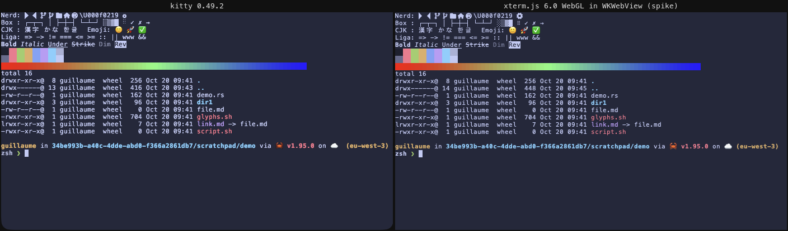
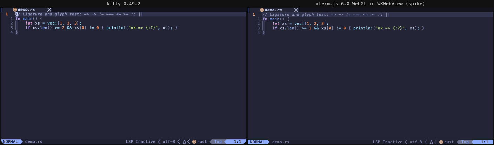
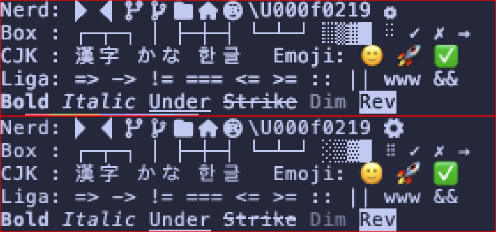
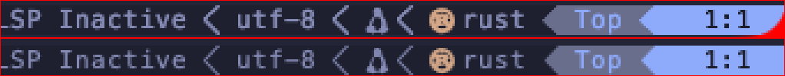
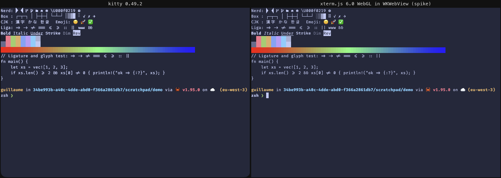
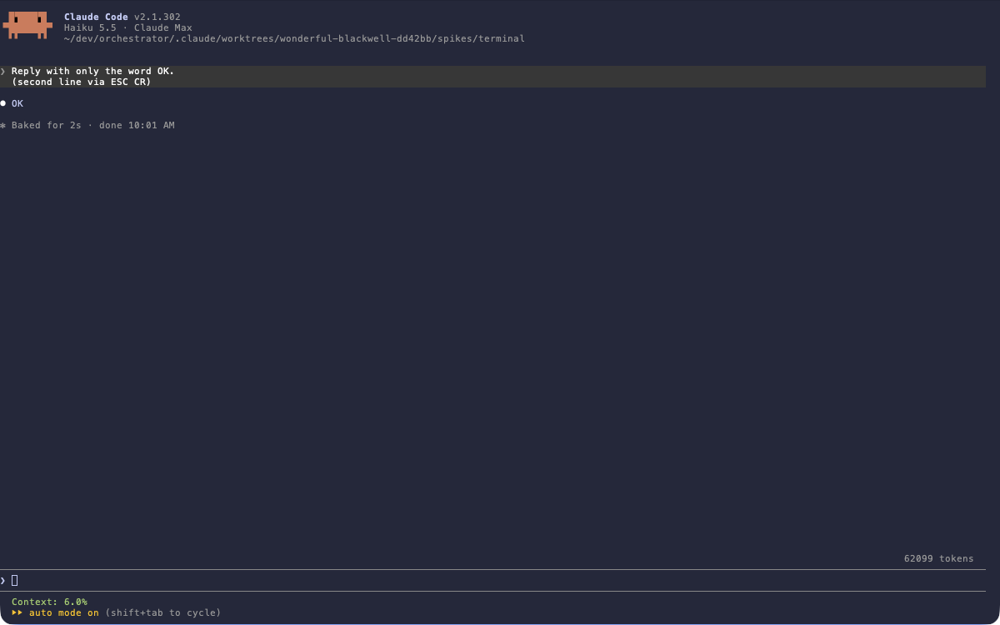

# P0 spike: terminal panes in WKWebView (SPEC §11 item 5, NFR-1b baseline)

- Date: 2026-10-20
- Machine: macOS 27.0 (Darwin 27.0.0), arm64, 8 GB RAM, **under memory pressure for the whole run**: 27–39 % free memory, 5.5–6.1 GB of a 7 GB swap in use. The app window sat on an external 4K display running at **30 Hz** with 1× scaling (`devicePixelRatio` 1). Frame times below are capped by that 33 ms vsync.
- Software: Tauri 2.12.4 (wry, system WKWebView), xterm.js 6.0.0 with addon-webgl 0.19.0, addon-ligatures 0.10.0, addon-unicode11 0.9.0, addon-fit 0.11.0. Svelte 5.57, Vite 8. Rust 1.95, portable-pty 0.9. kitty 0.49.2, nvim 0.11.4, Claude Code 2.1.302.
- Harness: [spikes/terminal/](../../spikes/terminal/README.md). It is a release `.app` bundle. The Rust core owns the PTYs and runs the user's login shell (`-zsh`) with a minimal env (HOME, USER, LOGNAME, SHELL, TMPDIR, LANG, a base PATH, `TERM=xterm-256color`, `COLORTERM=truecolor`). The shell profile builds the rest. A Unix control socket drives the UI, and the UI reports results back to a log.
- **UI framework: Svelte 5.** It compiles away and ships a small runtime, and runes are enough for this imperative, xterm-heavy UI. Nothing in the spike favoured SolidJS over it. The JS bundle is 713 kB minified (203 kB gzip). Most of that is xterm.js and the ligatures addon (opentype parsing). Svelte is a few kB of it.
- Constraints respected: `~/.config/kitty/*` was only read. Nothing was written to `~/.claude` by the harness. `ANTHROPIC_API_KEY` was never set. One `claude --model haiku` session with one trivial prompt ran in a pane. Every process the spike started was closed (app, 3 kitty windows, shells, nvim, claude).
- **Limits**: computer control of the app was declined and the screen locked for part of the run. So **no physical keystrokes** were sent: keyboard behavior was tested with synthetic DOM events, which bypass AppKit (see §3). Measurements taken while the screen was locked were thrown away and re-run unlocked. WKWebView stops `requestAnimationFrame` and throttles timers when the screen is locked or the window is fully hidden.

## Summary

| # | Item | Result | One-line finding |
|---|---|---|---|
| 1 | kitty look | **PASS after 4 fixes** | Side-by-side with kitty is near pixel-identical once the core (a) loads fonts itself (**WKWebView hides user-installed fonts**), (b) resolves the font the way kitty does (**the user's kitty actually renders Menlo**: its `font_family` name does not resolve), (c) loads kitty's bundled Nerd Font symbols, and (d) fixes cell rounding (kitty rounds the width up, xterm.js rounds it down) and line height. |
| 2 | nvim and `claude` in a pane | **PASS** | nvim with the full config: truecolor theme, SGR mouse (click and wheel), `"+` clipboard both ways, copy-on-select. Claude Code renders and answers. **Shift+Enter submits** instead of adding a newline; ESC CR works. |
| 3 | Keyboard contract §9.7 | **PARTIAL** | Bytes match kitty's legacy encoding for 40 keys. Conflicts: **`Ctrl-Space` is the macOS "previous input source" shortcut on this Mac** (2 keyboard layouts) and is nvim-cmp's `<C-Space>`. **Shift+Enter** equals Enter. `Ctrl-/`, `Ctrl-.`, `Ctrl-;` and all `Ctrl-Shift-<letter>` send **nothing**. `Ctrl-I`=Tab, `Ctrl-M`=Enter, `Ctrl-H`/`Ctrl-[` as usual. xterm.js has **no kitty keyboard protocol**. The AppKit layer (menu key equivalents, input sources) is not verified with real keys. |
| 4 | Several panes | **FAIL with Channels, PASS with pull** | Pushing PTY output through Tauri `Channel`s blocks the UI for **2–5 s** with 6 busy panes, costs 2.2 M IPC messages, and **one run stalled 2 of 6 panes for good** (a lost channel message). A **pull** transport (`invoke` returns raw buffered bytes) keeps 6 busy panes at **p95 35 ms, max 50 ms** frames and is 2–7× faster. WebKit's limit is **16 live WebGL contexts**. FR-1005 (hidden panes drop WebGL) works: 24 terminals in 4 tabs, 6 live contexts, 0 lost. |
| 5 | Memory (phys_footprint) | **PASS for the idle baseline, WARN per pane** | App + WebContent/GPU/Networking helpers with no pane: **72–78 MB** (target ≤ 250 MB). With **1 WebGL pane: 219–224 MB**, because the GPU helper jumps 13 → 124 MB. With 6 idle WebGL panes: 239–244 MB. With 6 panes after heavy output: 368 MB (pull) to 517 MB (Channel). The DOM renderer costs far less: 88 MB (1 pane), 104 MB (6). |

## 1. kitty look

### What the user's kitty really renders

`~/.config/kitty/kitty.conf` (78 kB, mostly comments) includes `tokyonight_storm.conf`. The importer follows `include` and keeps the last value of each key. Running kitty with `--debug-font-fallback` showed:

```
The font FiraCode-Regular Nerd Font was not found, falling back to Menlo
The font FiraCode-Bold Nerd Font was not found, falling back to Menlo
Normal: Menlo-Regular: /System/Library/Fonts/Menlo.ttc     cell_height: 13
```

- `font_family FiraCode-Regular Nerd Font` is neither a family nor a PostScript name, so **kitty falls back to Menlo**. The family `FiraCode Nerd Font` is also refused, because kitty only accepts monospaced fonts and that variant has wide icons. Only **`FiraCode Nerd Font Mono`** resolves (bold → `FiraCodeNFM-SemBd`). `disable_ligatures always` is set too.
- So "renders like kitty" means **Menlo 11 pt, no ligatures, kitty's built-in Nerd symbols**. The importer now copies kitty's behavior: it uses an exact CoreText family match and otherwise Menlo. It lists the unresolved name as unmapped. The user may want to fix their kitty.conf (`font_family FiraCode Nerd Font Mono`); that is outside this spike.

### Fixes needed in xterm.js on WKWebView

| Problem | Evidence | Fix in the spike |
|---|---|---|
| **WKWebView hides user-installed fonts** (`~/Library/Fonts`) from pages | A canvas text width for `"FiraCode Nerd Font"` was identical to the `serif` fallback (169.55 px). After loading the files it was 172.31 px | The core finds the family's files with CoreText (`core-text` crate) and returns their bytes. The UI registers them with `new FontFace()`. Each face is about 2.7 MB (regular + bold loaded). System fonts (Menlo) need nothing |
| Nerd Font glyphs show as tofu | kitty bundles `SymbolsNerdFontMono-Regular.ttf`. WebKit can't see any installed copy | Load kitty's own file (`/Applications/kitty.app/Contents/Resources/kitty/fonts/`) as a fallback family |
| **Cell width**: kitty 7 px, xterm.js 6 px for Menlo 11 (advance 6.62 px) | kitty rounds the advance up, xterm.js rounds it down. 100 columns were 600 px instead of 701 px | `letterSpacing = ceil(w) − floor(w)` in device px. The grid then matches column for column |
| **Line height** with FiraCode: kitty 16 px, xterm.js 13 px | kitty uses CoreText line origins (ascent + descent + leading). xterm.js measures glyph height | `lineHeight = kittyCell / xtermCell` (16/13). The product must compute kitty's cell height from CoreText metrics in the core. Menlo already matched (13 = 13) |

Side-by-side, same 100×30 grid, same shell content (left kitty, right the spike):





Zoomed 3× (top kitty, bottom xterm.js):




Judgment:
- **Font rendering**: same glyphs, same grid, same baseline. kitty's text is slightly **heavier**: its own gamma and contrast (`text_composition_strategy`) vs WebKit's canvas grayscale antialiasing. Only visible when zoomed in.
- **Colors**: identical palette, truecolor gradient identical. kitty's background measured `#25283a` vs `#24283b`: a color-profile difference of 1 unit.
- **Nerd Font glyphs**: present in both. kitty scales symbols to fit the cell (the gear U+F013 is smaller). xterm.js draws them at font size, so a few wide icons overflow a little. Powerline separators are crisp in both: xterm.js draws them as custom glyphs.
- **Box drawing and blocks**: both use custom drawing, and they look the same.
- **Emoji and CJK**: both double-width and aligned.
- **Ligatures** (FiraCode Mono, forced on in both, below): the ligatures addon works with WebGL, using its built-in fallback ligature list (the Local Font Access API isn't in WKWebView). `=> -> != === <= >= ||` render the same as in kitty. Difference: **italic**. FiraCode has no italic face; kitty draws upright, WebKit synthesizes an oblique.



### Mapping table (from the user's config)

| kitty | xterm.js / app |
|---|---|
| `font_family` (resolved like kitty), `bold_font` | `fontFamily` `"Menlo", "Symbols Nerd Font Mono", monospace`, `fontWeightBold` |
| `font_size 11.0` | `fontSize 11` (1 pt = 1 CSS px on macOS). Plus `letterSpacing` for cell rounding |
| `adjust_line_height` / `modify_font cell_height` | `lineHeight` (ratio). Absolute px needs the measured cell. `modify_font baseline` has no equivalent |
| `foreground`, `background`, `selection_*`, `cursor`, `cursor_text_color`, `color0–15`, `color16+` | `theme` (incl. `extendedAnsi`) |
| `cursor_shape`, `cursor_shape_unfocused`, `cursor_beam_thickness`, `cursor_blink_interval` | `cursorStyle`, `cursorInactiveStyle`, `cursorWidth`, `cursorBlink` (on/off only) |
| `window_padding_width` | CSS padding of the pane |
| `background_opacity` | rgba background + `allowTransparency`. Also needs a transparent Tauri window (`macOSPrivateApi`). Not exercised: the user's value is 1 |
| `scrollback_lines` | `scrollback` |
| `disable_ligatures` | load or skip the ligatures addon |
| `macos_option_as_alt no/yes/both` | `macOptionIsMeta` |
| `copy_on_select yes` | `onSelectionChange` → `navigator.clipboard.writeText` (works in WKWebView without a user gesture) |
| `map <key> send_text all <bytes>` | key remap in the pane's key handler (`alt+left` → `ESC b`, `alt+right` → `ESC f`) |

**Not mappable** (listed by the importer for this config): `macos_option_as_alt left/right` (xterm.js has no one-sided Option); `url_color`/`url_style`; `term xterm-kitty` (TERM stays `xterm-256color`); `shell_integration`; `modify_font baseline`; the cursor blink interval; `text_composition_strategy` (glyph weight and gamma); symbol scaling to the cell; `symbol_map`/`narrow_symbols`/`font_features`; kitty actions in `map` (`launch`, …); tab bar and border colors (`tab_bar_style`, `active_tab_*`, `*_border_color`: app chrome, usable for §9.1 theme derivation). `editor` and `allow_remote_control`/`listen_on` are not pane options but are useful: a default for FR-1102 and a channel for FR-1004 ("Open in kitty" via `kitty @`).

## 2. nvim and Claude Code inside a pane

| Check | Result |
|---|---|
| Login shell | `-zsh` with the user's profile, prompt, nvm/bob PATH. A minimal env was passed (no inherited `CLAUDECODE`, etc.) |
| nvim starts with full config | Yes: theme, lualine/powerline statusline, tabline, devicons (see screenshot) |
| Colors | Truecolor theme identical to kitty |
| Mouse | `mouseTrackingMode: drag`. Synthetic click → `ESC[<0;9;4M` / `ESC[<0;9;4m`, wheel → `ESC[<65;9;4M` (SGR) |
| Clipboard | `"+yy` → macOS pasteboard has the line. `pbcopy` → `"+p` pastes it. nvim uses `pbcopy`/`pbpaste` itself, so the terminal isn't involved. OSC 52 is **not** supported by xterm.js without `addon-clipboard` (not tested) |
| copy_on_select | Selecting in the pane put the text on the macOS pasteboard |
| `claude --model haiku` (in a trusted folder, `DISABLE_AUTOUPDATER=1`) | Renders: banner, prompt box, statusline (user's), hints. One prompt got the reply "OK" (screenshot below) |
| Newline in the Claude prompt | `ESC CR` (Option-Enter's bytes) adds a line. **Shift+Enter sends `CR` and submits.** Claude Code relies on the kitty keyboard protocol or `/terminal-setup` for Shift+Enter. The app should remap Shift+Enter → `ESC CR` in agent panes |



## 3. Keyboard contract (§9.7)

Method: `KeyboardEvent`s dispatched on xterm's textarea, with the pane's writes captured. This checks xterm.js's encoding and the app's key handler (leader, ⌘ pass-through, remaps). It **does not** check AppKit: menu key equivalents, input-source shortcuts, dead keys and IME. Those need physical keys (see open items).

| Key | Bytes to PTY | kitty (legacy mode) / note |
|---|---|---|
| Tab / **Ctrl-I** | `\t` / `\t` | Same in kitty legacy. Only the kitty protocol separates them; **xterm.js 6 does not implement it** (nor `modifyOtherKeys`) |
| Shift-Tab | `ESC[Z` | same |
| Esc / Ctrl-[ | `ESC` / `ESC` | same |
| Enter / **Shift-Enter** / Ctrl-Enter / Ctrl-M | `\r` for all | Shift-Enter can't be told apart: Claude Code submits |
| Opt-Enter | `ESC \r` | newline in Claude Code |
| Backspace / Ctrl-H / Opt-Backspace | `\x7f` / `\x08` / `ESC \x7f` | same |
| Ctrl-P / Ctrl-C / Ctrl-Z / Ctrl-\ / Ctrl-J | `\x10` `\x03` `\x1a` `\x1c` `\n` | same |
| **Ctrl-Shift-P** (any Ctrl-Shift-letter) | **nothing** | kitty sends `\x10` (and uses ctrl+shift for its own shortcuts) |
| **Ctrl-/**, **Ctrl-.**, **Ctrl-;** | **nothing** | kitty sends `\x1f` for Ctrl-/. nvim mappings on these keys won't fire |
| Ctrl-Opt-a | nothing | — |
| Opt-b with `macOptionIsMeta false` | `∫` (composed char) | matches `macos_option_as_alt no` |
| Opt-Left / Opt-Right | `ESC b` / `ESC f` | from the user's kitty `map` lines (remap) |
| Ctrl-Left / Shift-Right / Up / Home / PageUp | `ESC[1;5D` `ESC[1;2C` `ESC OA` `ESC OH` `ESC[5~` | same |
| F1 / F12 / Shift-F5 | `ESC OP` `ESC[24~` `ESC[15;2~` | same |
| Shift-PageUp | nothing (xterm.js scrolls its scrollback) | kitty also scrolls |
| ⌘C / ⌘K / ⌘← | nothing (handler returns false) | ⌘C falls through to the native Copy menu item |
| **Leader** Ctrl-Space | armed, nothing sent | — |
| Ctrl-Space twice | `\x00` | as specified |
| Leader then `z` | zoom toggled, nothing sent | as specified |

Conflicts found:
1. **`Ctrl-Space` (the default leader) is taken by macOS on this Mac.** `com.apple.symbolichotkeys` id 60 "Select the previous input source" = ⌃Space is enabled, and 2 layouts are active (U.S. International – PC, ABC). The keystroke switches the layout and never reaches any app, kitty included. It is also nvim-cmp's `<C-Space>` (complete) in the user's config, so they would have to double-tap it.
2. **Shift+Enter** cannot add a newline in Claude Code (see §2).
3. **`Ctrl-/`, `Ctrl-.`, `Ctrl-;`, `Ctrl-Shift-<letter>`** are dropped by xterm.js. The user's nvim config doesn't map them today. Common plugins do (`<C-/>` comment toggle).
4. Legacy collisions as in any non-kitty-protocol terminal: `Ctrl-I`/Tab, `Ctrl-M`/Enter, `Ctrl-[`/Esc, `Ctrl-H`/Backspace. The user's nvim maps `<C-h>`/`<C-j>`/`<C-k>`/`<C-l>` (window moves); these still work because nvim reads `\x08` as `<C-h>`.
5. **⌘ chords vs Tauri's default macOS menu**: Tauri installs ⌘Q, ⌘H, ⌥⌘H, ⌘W (Close Window), ⌘M, ⌃⌘F, ⌘Z/⇧⌘Z, ⌘X/C/V/A. ⌘W in §9.7 means "close pane"; with the default menu it can close the window. **Not verified with physical keys.** The app must ship its own menu. In the spike, every ⌘ keydown that reaches the webview is handled or `preventDefault`ed.

## 4. Several panes, throughput and WebGL

Tests: 1 pane, then 6 panes (3×2 grid, 55×28 each), all WebGL. `yes | head -n 2000000` gives 6 MB of output in 2 M lines. `cat` of a 25 MB colored file gives 200 k lines. Each run is timed until xterm.js has **parsed** a sentinel OSC printed after the command. Frame times are `requestAnimationFrame` deltas during the run (vsync is 33 ms on this display). The screen was unlocked and the window visible (always-on-top, unfocused).

Three transports for PTY output (all in [main.rs](../../spikes/terminal/src-tauri/src/main.rs)):
- **Channel**: `Channel<InvokeResponseBody::Raw>` with one message per PTY read, plus byte-count acks for flow control (2 MB high, 512 kB low watermark).
- **Coalesce**: Channel, but the reader keeps reading for up to 8 ms (up to 512 kB) before sending.
- **Pull**: the reader appends to a per-pane buffer (blocking above 2 MB). The UI loops on `invoke('pty_read')`, which returns everything buffered as a raw `ipc::Response`, and asks again once xterm.js has parsed it.

| Run | Channel | Coalesce 8 ms | **Pull** |
|---|---|---|---|
| `yes` 1 pane | 5.5 s · frames p95 423 / max 1419 ms | 5.5 s · p95 832 / max 1209 ms | **2.2 s · p95 35 / max 37 ms** |
| `cat 25 MB` 1 pane | 2.3 s (10 MB/s) · p95 147 ms | 0.42 s (57 MB/s) · p95 52 ms | **0.32 s (74 MB/s) · p95 49 ms** |
| `yes` 6 panes at once | 25.8 s · p95 2241 / **max 3767 ms** | 23.0 s · p95 3538 / **max 4935 ms** | **12.2 s · p95 35 / max 50 ms** |
| `cat 25 MB` 6 panes at once | 13.3 s (1.8 MB/s/pane) · p50 213 ms; **an earlier run stalled 2 panes for good** | 2.3 s (10.5 MB/s/pane) · p95 88 ms | **1.9 s (13 MB/s/pane) · p95 100 ms** |
| IPC messages for the whole run | 2.21 M | 1.99 M | **0.10 M** |
| Idle frames, 1 and 6 panes | p95 34–37 ms (= vsync) | same | same |

Findings:
- **Tauri Channels are the bottleneck**, not xterm.js. Each message under 1 kB is an `eval` of a JSON number array (`new Uint8Array([…])`). Each larger message is an `eval` plus a `fetch` round trip. PTY reads are mostly small (≈ 1 kB), so busy panes generate millions of evals on the WebContent main thread. Coalescing helps big bursts (`cat`) but not line-by-line output (`yes`).
- **Channel stall**: in the first 6-pane `cat` run, 2 panes stopped for good at 24.0 and 25.0 MB. The UI had parsed and acked everything it received, and the reader was blocked on flow control. The log had Tauri's `Couldn't find callback id …`. Tauri's large-message path does `invoke(fetch).then(runCallback).catch(console.error)`, and the JS Channel delivers in index order. So one lost message blocks the channel forever. The stall was not reproduced in the unlocked re-run, but it can happen and is silent.
- **Pull** gives batching and backpressure for free: one request per batch, raw bytes, and no timer-based acks. The timer-based acks also misbehave when WKWebView throttles timers (screen locked, window hidden). With pull, the UI stays at vsync while 6 panes stream.
- xterm.js parse cost is mostly per line: about 0.9 M lines/s for one pane (pull, `yes`), shared across panes on one thread. kitty was not benchmarked for comparison.

**WebGL context limit (R9).** 24 visible WebGL terminals were created in one page: all 24 got a context, then WebKit **lost the 8 oldest** ("webgl context not restored"). The limit is **16 live contexts per page**. The lost terminals fall back to the DOM renderer through `onContextLoss`.

**FR-1005** (hidden panes drop their WebGL context and keep their buffer): implemented as `hide()` → `WebglAddon.dispose()` and `show()` → new `WebglAddon`.

| 4 tabs × 6 panes = 24 terminals, switching tabs 6 times | Live contexts | Contexts lost | phys_footprint |
|---|---|---|---|
| FR-1005 on | **6** (only the visible tab) | **0** (60 created over time) | 200 MB |
| FR-1005 off | 16 (capped by WebKit) | **16**: visible panes too, thrashing on every tab switch | 265 MB |

Reattaching costs a texture-atlas rebuild. It was not noticeable on tab switch at this size.

## 5. Memory (phys_footprint, `footprint -p`, MB)

Measured on the release bundle: the app process (Rust core + Tauri) plus the 3 WebKit helpers that start with it, `com.apple.WebKit.WebContent`, `.GPU` and `.Networking`. No other WebKit client was running, so they are attributable. Shells are separate processes: each `zsh` is about **5.2 MB**, not counted below. The system had 27–39 % free memory and 5.7–6.1 GB swap used. Footprints were stable over 70 s.

| State | Core | WebContent | GPU | Network | **Total** |
|---|---|---|---|---|---|
| No pane (fonts loaded) | 25–29 | 28–30 | 13 | 7 | **72–78** |
| 1 pane, WebGL | 26–28 | 62–67 | **124** | 7 | **219–224** |
| 1 pane, DOM renderer | 26 | 42 | 14 | 7 | **88** |
| 6 idle panes, WebGL | 27 | 81–83 | 124–128 | 7 | **239–244** |
| 6 idle panes, DOM renderer | 29 | 54 | 15 | 7 | **104** |
| 6 panes, WebGL contexts dropped and recreated once | 27 | 95 | **26** | 7 | **155** |
| 24 terminals in 4 tabs, FR-1005 on (6 live) | 28 | 136 | 29 | 7 | **200** |
| 6 panes after heavy output (2000-line scrollback each), pull | 48 | 177 | 137 | 7 | **368** |
| same, Channel | 72 | 313 | 126 | 7 | **517** |

- **NFR-1b passes**: 72–78 MB with nothing running, against ≤ 250 MB.
- **The first WebGL terminal adds ~110 MB to the GPU helper**: 100 MB of "owned physical footprint (graphics)". The extra terminals add almost nothing. The 100 MB **goes away (GPU ≈ 26–30 MB)** when the contexts are dropped and recreated, or when the canvas is really resized, and comes back when a *new* terminal gets its first context. `clearTextureAtlas()` and a no-op resize event didn't release it. The cause is not identified (follow-up).
- WebContent grows with scrollback and with IPC garbage. Channel transport left 136 MB more than pull after the same output.
- Per-pane cost with WebGL is small once the first one is paid (+3–4 MB each for idle panes), and the DOM renderer is cheap. At 6 visible panes, WebGL costs ~135 MB more than DOM, almost all in the GPU helper.

## Proposed SPEC / ADR edits (not applied)

1. **ADR-001 §4**: "PTY output reaches the UI through Tauri 2 Channels with binary payloads" → **"…through a pull command (`pty_read`) that returns all buffered bytes as a raw IPC response. The core buffers per pane with a high watermark, which gives backpressure."** Record Channels' measured cost (2–5 s UI stalls with 6 busy panes) and the stall risk (a lost message blocks the channel). Keep Channels for low-rate events.
2. **ADR-001 §1**: the UI is **Svelte 5**, decided in P0 (this spike).
3. **ADR-006 / FR-1002**: add how the kitty look is reproduced:
   - the core resolves `font_family` **as kitty does** (exact family, monospace only, else Menlo) and warns when kitty itself can't resolve it;
   - the core loads font files for the UI (CoreText lookup, then `FontFace`), because WKWebView hides user-installed fonts;
   - it loads kitty's bundled `SymbolsNerdFontMono` as the symbol fallback;
   - it computes cell width (round up) and line height from CoreText metrics.
   
   The acceptance test compares against what kitty actually renders (`--debug-font-fallback`), not against what kitty.conf says. Add the unmapped list from §1.
4. **FR-1005**: confirmed. Add "**WebKit allows 16 live WebGL contexts per page**; a lost context falls back to the DOM renderer". Consider a cap on visible WebGL panes (e.g. 12) and the DOM renderer for small or idle panes, given the GPU cost below.
5. **§9.7 Keyboard contract**:
   - The default leader `Ctrl-Space` conflicts with macOS's input-source shortcut (enabled here) and with nvim-cmp. Propose a ⌘-based leader (e.g. `⌘;`), since ⌘ never reaches the PTY, or at least make the conflict checker (FR-1204) read `com.apple.symbolichotkeys`.
   - Add: Shift+Enter → `ESC CR` in agent panes.
   - Add: the app ships its own macOS menu (no Close Window ⌘W, Hide ⌘H or Minimize ⌘M stealing §9.7 chords).
   - List the keys xterm.js drops (`Ctrl-/ . ;`, `Ctrl-Shift-<letter>`) and the missing kitty keyboard protocol as known limits.
   
   Record these on Penpot page `05` as §9.7 asks.
6. **NFR-1b**: set the measured baseline: **app ≈ 75 MB idle; ≈ 220 MB with the first WebGL pane** (≈ 110 MB of it in the GPU helper); ≈ 240 MB with 6 idle panes; ≈ 5 MB per shell outside the app. Count the GPU helper in the app's own memory display (ADR-001 §5). Add a test: 6 panes after heavy output ≤ 400 MB. Note that measurements need an unlocked screen and a visible window.
7. **NFR-1**: input-to-paint with 6 terminals is reachable only with the pull transport (6 panes streaming: frames p95 35 ms, max 50 ms vs 2–5 s stalls with Channels).
8. **R9**: mostly retired. Fidelity is good after the fixes above; the context limit is measured and handled by FR-1005. Remaining: the GPU-memory spike, physical-key checks, and Retina/120 Hz rendering (only 1× / 30 Hz was tested).
9. **FR-1004 / FR-1102**: kitty.conf's `listen_on`/`allow_remote_control` and `editor` can feed "Open in kitty" (`kitty @ launch --cwd`) and the default editor path.

## Open items

- Physical keystrokes: ⌘ chords vs the menu, Ctrl-Space with the input-source shortcut, dead keys of the U.S. International – PC layout, and IME composition. They need a human at the keyboard or an approved computer-control session.
- The ~100 MB GPU-helper allocation on a terminal's first WebGL context: find what holds it and whether a drop-and-recreate after creation is a safe workaround.
- Rendering on the built-in Retina display (dpr 2, 120 Hz) and with `background_opacity < 1` (transparent window).
- A kitty throughput reference on the same files, and an input-latency measurement (keydown → paint) for NFR-1.
- OSC 52 clipboard (needs `@xterm/addon-clipboard`) for programs that copy through the terminal.
